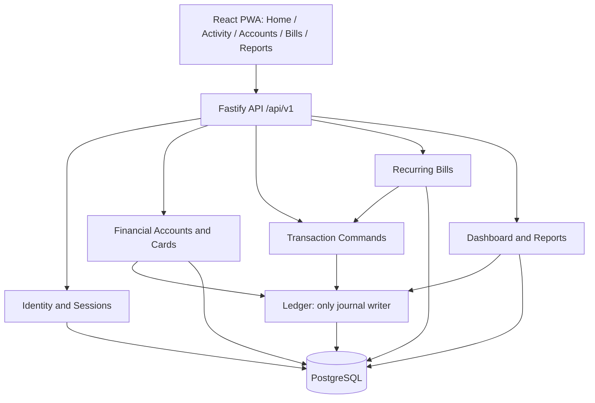
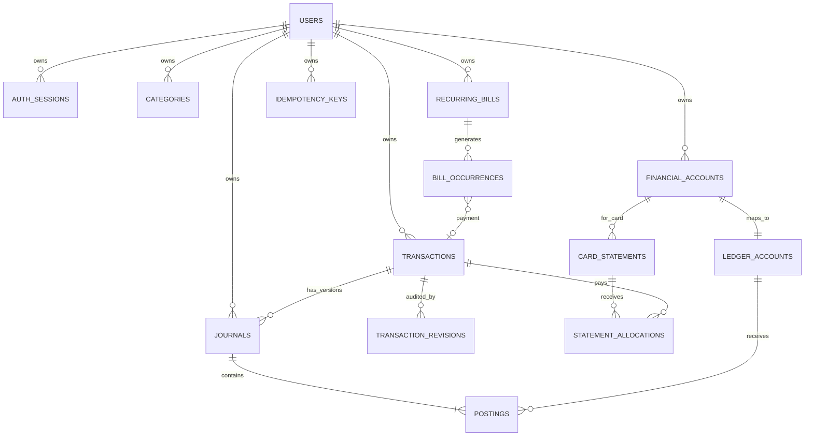
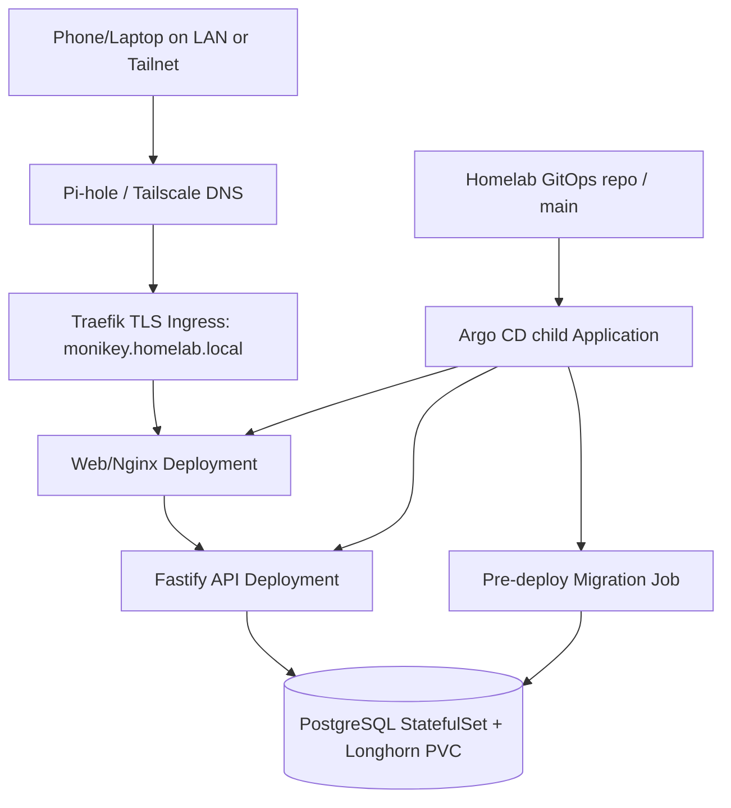

# MoniKey V2 — Master Product, Architecture & Implementation Plan

**Status:** Approved product specification; implementation blueprint (no code has been created or deployed)  
**Version:** 1.0  
**Prepared:** 2026-10-22 (Philippine Time)  
**Product owner:** MoniKey project owner  
**Implementation repository:** `Jeysibn/monikey-v2` (new repository, to be created)  
**Reference-only V1:** https://github.com/Jeysibn/monikey  
**Existing GitOps repository:** https://github.com/Jeysibn/homelab-gitops  
**Target environment:** Docker Compose locally; existing k3s + Argo CD GitOps homelab in production

> **MANDATE** — Build V2 from scratch. Do not import or incrementally refactor V1 application code, database schema, routes, providers, or UI. V1 is evidence and inspiration for proven patterns, tests, and CI. V2 starts with empty financial data and replaces the existing production MoniKey only at a controlled, approved cutover.

> **DELIVERY RULE** — Every feature is a complete vertical slice: financial specification → schema/migration → API contract → backend → frontend → actual Postgres tests → Playwright tests → independent QA → documentation. An attractive page backed by fake finance logic is **not** a completed feature.

---

## 0. How to use this document

1. Read **Sections 1–6** before coding; these are the approved product constraints, design rules, and financial invariants.
2. Read **Sections 7–12** for the target architecture, schema, contracts, security, and deployment.
3. Implement work in the dependency order in **Section 13**, using issue IDs and acceptance criteria.
4. Use **Sections 14–16** as the CI, release, QA, and coding-agent contract.
5. Record any material design deviation as an Architecture Decision Record (ADR), obtain owner approval, update this plan, then implement. Do not silently reinterpret decisions.
6. The examples here are **design contracts**, not commands to apply blindly. Inspect the live homelab GitOps manifests, installed versions, CRDs, and storage before applying Kubernetes changes.

**Interpretation:** `MUST` is a release requirement; `SHOULD` is the implementation default unless a documented ADR justifies otherwise; `LATER` is explicitly excluded from the V2 launch scope. All amounts displayed to users are Philippine Pesos (PHP).

### 0.1 Source/reference boundary

The V1 repository currently documents React/Vite, Fastify, Prisma, PostgreSQL, a separate worker, in-memory mock mode, and backend mode with differing capabilities. Its CI documentation says fast validation includes mock-mode Playwright while full-stack backend-connected tests are in a distinct workflow. The homelab repository documents k3s, Argo CD, Traefik, MetalLB, Longhorn, Pi-hole, and `monikey.homelab.local` in namespace `monikey`. These are verified **reference facts**, not a license to copy files or assume that deployed cluster state perfectly matches Git.

**References (checked 2026-10-22):**
- [MoniKey V1 README](https://github.com/Jeysibn/monikey/blob/main/README.md)
- [MoniKey V1 architecture](https://github.com/Jeysibn/monikey/blob/main/docs/ARCHITECTURE.md)
- [MoniKey V1 CI/CD operations](https://github.com/Jeysibn/monikey/blob/main/docs/CI-CD-Operations.md)
- [Homelab GitOps README](https://github.com/Jeysibn/homelab-gitops/blob/main/README.md)
- [Homelab service catalog](https://github.com/Jeysibn/homelab-gitops/blob/main/docs/Service-Catalog.md)

### 0.2 Product success criteria

The product is successful when its owner can use it daily without needing an auxiliary spreadsheet and without doubting the account balances. Success does **not** mean feature parity with V1.

| Metric / experience | Acceptance target |
|---|---|
| First use | Login, guided first-account setup, and functional dashboard in one short flow |
| Daily transaction | Normal expense entered from mobile quick-add with amount, account, category, today as default |
| Accounting | No duplicate revenue/expense from transfers or card payments; journal stays balanced |
| Persistence | Records survive reloads, logout/login, process restarts, and redeploys |
| Navigation | Four primary mobile actions; secondary details accessed contextually |
| Testing | All merge-blocking checks use real PostgreSQL and a real API for financial E2E paths |
| Design | Premium minimal royal-blue/deep-navy UI, functional light/dark modes, accessible motion |
| Deployment | Approved image digests deployed by existing Argo CD via GitOps; controlled V1 replacement |
| Isolation | No user can access another user's financial information, even by guessing IDs |

---

## 1. Product charter and non-goals

### 1.1 Target user and use cases

**Primary user:** a single individual tracking personal cash, banks, e-wallets, and credit card liabilities. Private family accounts can be added later with **independent, non-shared financial data**, not a collaborative household wallet.

**Top daily jobs:**
1. Open the phone and see recorded **Available Money**.
2. Add an expense/income in seconds, using the correct account.
3. Check a bank/e-wallet/card balance and chronological transaction history.
4. Record transfers and card payments without corrupting spending figures.
5. See upcoming fixed/variable bills and manually mark payment.
6. On desktop, investigate transactions, statements, and monthly spending charts.

### 1.2 Three product promises

1. **Trust the numbers.** The server is the sole source of financial truth; no independently maintained frontend finance engine.
2. **Fast everyday use.** Few screens, contextual navigation, quick-add, great touch interactions, and useful empty/loading/error states.
3. **Beautiful, not busy.** Professional blue visual identity and restrained animation; no dashboard clutter or decorative 3D inside transaction workflows.

### 1.3 Explicitly in V2 launch scope

- Private authentication, session management, guided onboarding, user preferences and ownership.
- Account creation, rename, ordering and archival for **cash, banks, e-wallets, credit cards**.
- PHP opening balances; calculated balances; explicit manual adjustment, with audit trail.
- Income, expense, account-to-account transfer, linked transfer fees, linked refunds, credit card purchase/payment; edit, logical delete/reverse, full history.
- Customizable income and expense categories; no subcategories or tags in V2.
- Credit card limits, utilization, statement dates, **actual manually entered statement amounts**, due dates, full/partial payments.
- Recurring fixed/variable bills, upcoming/overdue visibility, one-tap **confirmation** that records a real payment; no automatic debit.
- Home dashboard: Available Money, Net Financial Position, income, spending, accounts, upcoming bills, recent activity.
- Unified Activity search/filter and account-specific detail views.
- Basic monthly reports: income, expense, net cash flow, spending by category, simple visual comparisons.
- Downloadable owner-controlled transactions CSV and structured data JSON export.
- Installable online-first PWA, privacy hide/reveal, light/dark modes, reduced-motion support.
- Docker Compose local development; k3s + Argo CD + GitOps deployment; required CI, backups, monitoring, release runbooks.

### 1.4 Excluded until a separately approved later version

**Do not add**: budgets, goal savings, crypto/stocks/investments, property valuation, loans, bank/wallet APIs, Plaid, OCR, receipt storage, AI insights, push/email notifications, bank CSV import, automated categorization, offline writes or sync queue, multiple currencies, advanced reporting or custom ranges, split-category transactions, tags, rules, recurring auto-posting, shared-family wallets, public registration, microservices, RabbitMQ, Redis, dedicated worker, 3D dashboard, and separate production staging.

Future flexibility is good; speculative tables, screens, infrastructure, or adapter classes for these features are not.

### 1.5 Terminology (must stay consistent)

- **Financial Account:** visible cash/bank/e-wallet/card record belonging to one user.
- **Available Money:** aggregate signed balances of cash, bank and e-wallet asset accounts; **never** includes unused credit limit or deducts unpaid future bills automatically.
- **Card Outstanding:** signed liability owed to issuer; a card credit may display separately as a negative amount owed.
- **Net Financial Position:** available liquid assets minus card liabilities; **not** total lifetime net worth.
- **Transaction:** a user-recognizable financial action (expense, income, transfer, refund, payment, adjustment).
- **Journal:** immutable accounting record of balanced debit/credit postings supporting a transaction.
- **Reversal:** compensating journal operation, used when logically deleting or editing a posted transaction.
- **Adjustment:** explicit ledger correction, not an untraceable overwritten account balance.
- **Statement:** manually recorded card statement amount and due date, separate from live total card outstanding.
- **Bill occurrence:** one scheduled reminder/due instance for a recurring bill; no money moves until paid.
- **Financial date:** `YYYY-MM-DD` in `Asia/Manila`, distinct from server event timestamps.
- **Archive:** exclude from normal selection while preserving historical information.

---

## 2. Information architecture and route contract

Use React Router with one authenticated application shell. **Primary mobile navigation** is Home, Activity, **Add**, Accounts; Add is an action, not another full information page. Side destinations (Bills, Reports, Settings) are discoverable from Home and the account/menu area. Desktop may use the same information groups in a rail/sidebar, not a different route taxonomy.

| Route | Owner | Intended behavior |
|---|---|---|
| `/login` | Identity | Private sign-in, validation, rate-limit/error feedback |
| `/onboarding` | Accounts | Guided first account + opening balance; skip extra accounts |
| `/app` | Home | Dashboard; default authenticated landing page |
| `/app/activity` | Transactions | Chronological feed, search, filters, visible clear-all, URL-preserved filter state |
| `/app/transactions/new?kind=expense` | Transactions | Mobile bottom sheet when navigated contextually; direct link renders accessible full-page fallback |
| `/app/transactions/:transactionId` | Transactions | Details and edit/reverse actions; audit summary |
| `/app/accounts` | Accounts | Unified cash, bank, wallet, card overview |
| `/app/accounts/:accountId` | Accounts | Account balance, filtered history, actions |
| `/app/accounts/:accountId/statements` | Cards | Only for credit card accounts; statement/payment review |
| `/app/bills` | Bills | Upcoming, overdue, paid, skipped, add/edit recurring rules |
| `/app/reports` | Insights | Month selector, summary cards, category/chart breakdown |
| `/app/settings` | Settings | Profile, theme, category link, export, security |
| `/app/settings/categories` | Categories | Add/rename/archive categories |
| `/app/settings/security` | Identity | Password, sessions, revoke/logout |
| `*` | Router | Helpful 404 within correct authentication state |

**Route behavior constraints:**
- A browser reload or copied deep link MUST render the same logical screen after session recovery.
- Back/forward MUST restore the right detail view, filter and modal state without duplicate mutations.
- Deleted/archived/mismatched user IDs MUST return a safe 404/403 boundary; no data leak.
- Search/filter state belongs in URL query params, with server-owned financial totals.
- An Add sheet MUST support Escape/backdrop close, focus trapping, unsaved-change warning, and keyboard accessibility.
- Each route MUST have loading, empty, validation, error and unauthorized states; no permanently disabled placeholder pages.

### 2.1 Navigation and layout rules

- Touch targets at least **44 × 44 CSS pixels**, reachable one-handed.
- Mobile baseline: 360/375/390px; validate tablet 768px, desktop 1024/1440/1920px.
- Home prioritizes available money and account overview; bills/activity follow; charts live primarily on Reports.
- Quick add opens from prominent global `+`; default expense. Amount entry supports a calculator-friendly numeric pad, but the interaction remains a **single** form, not a multi-step wizard.
- Expense normally requires only amount, account and category; date defaults today; note/merchant are optional.
- Use meaningful content density: desktop gains space for inspection without oversized typography or scattered widgets.
- Hide/reveal money affects visible UI but **is not a security control**; authorized data still exists in API responses.

---

## 3. Visual language and interaction specification

**Direction:** premium minimal + selective expressive flourishes. Blue-led, finance-readable, light and dark, not neon, gamified, or dashboard-template clutter. Use a semantic token system, not hardcoded colors per component.

### 3.1 Initial token proposal (subject to contrast testing)

| Token | Light | Dark | Meaning |
|---|---|---|---|
| `brand.primary` | `#1D4ED8` | `#60A5FA` | Main action/selection |
| `brand.deep` | `#122343` | `#DBEAFE` | Identity/headings |
| `brand.accent` | `#38BDF8` | `#38BDF8` | Limited data/motion accents |
| `surface.page` | `#F7F9FC` | `#0B1220` | App background |
| `surface.card` | `#FFFFFF` | `#142036` | Cards/sheets |
| `surface.muted` | `#ECF2FA` | `#1C2B44` | Secondary groupings |
| `text.primary` | `#10213D` | `#F3F7FF` | Primary content |
| `text.secondary` | `#53657E` | `#A9BAD2` | Captions/metadata |
| `border.default` | `#DCE5F2` | `#2D405D` | Separators |
| `semantic.income` | accessible green | accessible green | Positive cash flow |
| `semantic.expense` | accessible warm/red | accessible warm/red | Expenses/negative context |
| `semantic.warning` | accessible amber | accessible amber | Negative balance/overdue |

**Acceptance:** WCAG AA contrast for body text and essential indicators. Never rely on color alone; positive/negative values include labels/signs and accessible screen-reader descriptions. Test both themes with real charts and screenshots.

### 3.2 Component library (build once)

`AppShell`, `BottomNav`, `DesktopNav`, `PageHeading`, `MoneyValue`, `PrivacyMask`, `AccountCard`, `SummaryStat`, `TransactionRow`, `CategoryPicker`, `AccountPicker`, `DatePicker`, `AmountInput`, `QuickAddSheet`, `ConfirmDialog`, `ErrorState`, `EmptyState`, `Skeleton`, `Toast`, `BillOccurrenceRow`, `CreditStatementCard`, `ChartFrame`, `FilterChips`, `ThemeToggle`.

Prefer native semantics and a small, accessible component primitive library over a huge UI framework. Choose icon and chart libraries only after checking bundle size, maintenance, accessibility and dark-mode behavior. Avoid reinventing accessible dialog/combo-box interactions.

### 3.3 Motion principles

- Micro-interactions around **120–220ms**; short intentional content transitions around **220–400ms** as appropriate. These are starting targets, not rigid values.
- Animate sheet entry, valid submission acknowledgement, balance delta, selected tabs, and chart transitions; **never** animate fake totals before confirmed server mutation.
- Honor `prefers-reduced-motion`, disable decorative movement and preserve usable state changes.
- Use CSS transforms/opacity where possible; no required WebGL, 3D, parallax or animated backgrounds inside finance workflows.
- UI must remain responsive on midrange mobile hardware and under slow network conditions.

### 3.4 Design deliverables before backend-connected UI work

1. One-page visual direction and token glossary.
2. Light/dark component states: default, hover, pressed, focus-visible, disabled, loading, error, empty.
3. Mobile + desktop wireframes for Home, Activity, Quick Add, Accounts, Account Detail, Card Statements, Bills, Reports, Settings.
4. Interaction specifications including routes, sheets, keyboard/focus, confirmations and server errors.
5. Screenshot regression references for common breakpoints/themes.

**Do not** block core backend implementation on illustrations, marketing landing pages or heavy animation.

## 4. Financial domain: rules, math, and non-negotiable invariants

**Architecture choice:** implement a small **double-entry accounting journal internally** while presenting intuitive consumer-friendly actions in the UI. This is not a general bookkeeping product: there are no accounting ledgers exposed as navigation pages. The journal exists to make transfers, card payments, refunds and corrections provably consistent.

### 4.1 Money and time types

- `MoneyMinor`: signed PostgreSQL `BIGINT`, serialized through JSON **only as a base-10 string**, e.g. `"125050"` = ₱1,250.50. No IEEE-754 floating point for stored calculations, API totals or reporting sums.
- User input like `1,250.50` is parsed at the UI boundary to precisely `125050` minor units, rejecting more than two fractional digits, invalid formatting, NaN and overflows. Never use `parseFloat(value) * 100`.
- Implement exact `bigint`/decimal-string helper methods in `packages/money` and centralize formatting with `Intl.NumberFormat('en-PH', { style: 'currency', currency: 'PHP' })` *only for display*; choose a safe formatter conversion for large values without losing precision.
- Financial date is an ISO `DATE` (`YYYY-MM-DD`) in Philippine Time (`Asia/Manila`); technical `created_at`/`updated_at`/audit events are UTC-aware `TIMESTAMPTZ`.
- The application allows **backdated** financial transactions but not future-dated posted transactions; future bills remain unpaid reminders, not balance-changing postings.
- Monthly periods: inclusive start date, exclusive next-month start date, evaluated as PHT business dates.

### 4.2 Journal entries and signs

Every posted user financial action creates a balanced journal: **sum of debits = sum of credits**. Account types are assets, liabilities, income, expenses and internal equity/adjustment. The financial model includes only what V2 actually tracks.

| Action | Debit (+) | Credit (-) | Reporting consequence |
|---|---|---|---|
| Opening cash/bank/e-wallet balance | Asset | Opening Equity | No income |
| Opening card outstanding debt | Opening Equity | Card Liability | No expense |
| Salary/income received | Asset | Income | Income increases |
| Expense paid from bank/cash/e-wallet | Expense | Asset | Spending increases |
| Move money bank → GCash | GCash Asset | Bank Asset | No income/expense |
| Transfer with fee | GCash Asset + Fee Expense | Bank Asset | Fee only is spending |
| Card purchase | Expense | Card Liability | Spending increases, debt increases |
| Credit card payment | Card Liability | Bank/E-wallet Asset | No new expense |
| Expense refund to bank | Bank Asset | Expense | Reduces net spending; linked original |
| Card-purchase refund on same card | Card Liability | Expense | Reduces debt and net spending |
| Correct an overstated asset balance | Adjustment Equity | Asset | No income/expense |
| Correct an understated asset balance | Asset | Adjustment Equity | No income/expense |
| Correct card liability | Liability / Adjustment Equity as needed | Counterpart | No artificial expense/income |

Notes:
- The `+/-` notation in this table is illustrative; actual journal posting records carry **debit/credit direction** and positive absolute minor units. Asset balances are debits minus credits; liability balances are credits minus debits.
- A refund is a **separately dated** action; a refund received in November against an October purchase reduces November net expenses in the original expense category, not October's original history. Reports can show negative category net-spend for a month if refunds exceed that month's purchases.
- A transfer fee amount is optional, nonnegative, explicitly visible and tied to a transfer. For ₱1,000 transferred and ₱15 fee, source decreases ₱1,015, destination increases ₱1,000, spending increases ₱15.
- Card repayments never affect income/expense summaries again. Purchase is recorded when purchased, not when paid off.
- Do not double-count movement between personal accounts in income, spending or net financial position.

### 4.3 Defined aggregate formulas

For signed asset balances `A_i` and signed card liability balances `L_j`:

```text
Available Money (minor)       = Σ(A_i) for CASH, BANK, EWALLET
Card Debt Outstanding (minor) = Σ(L_j), where L_j = credits - debits
Net Financial Position (minor)= Available Money - Card Debt Outstanding
Net Cash Flow (for period)    = Period income - Period net expenses
Period Net Expenses           = gross expenses - linked refund credits
```

- A credit card credit balance (`L_j < 0`) is allowed only after explicit confirmation and shown as a **credit balance**, not as imaginary available cash. It increases net financial position because of the subtraction in the formula, but is never merged with Available Money.
- If a manually entered transaction makes an asset account negative, warn with the projected balance and require affirmative confirmation; **do not block**. The signed negative remains visible.
- Credit utilization is based on current card debt and a positive recorded limit: `max(0, liabilityOutstanding) / creditLimit`. Present a percentage and warning if above 100%; do not silently enforce real issuer authorization rules. If the limit is missing, show utilization as unavailable.
- `Available Money` is not “safe to spend.” Future bills/statement amounts display separately and are never subtracted from current balances until payment is recorded.
- Card statement due is a **manually entered statement snapshot**, not a formula derived from all outstanding debt. A newer card purchase must not rewrite an old statement. Partial payments reduce `statementRemainingDue` via explicit allocations while also reducing overall card liability.

### 4.4 Corrections, deletion, history and idempotency

- UI permits editing and logical deletion; **never** update/delete posted journal rows directly. Reverse the prior journal and write a replacement journal in **one PostgreSQL transaction**; update the stable user-visible transaction revision atomically.
- A reversal uses the original financial effective date for current-state reporting correction while retaining the real UTC reversal timestamp for audit. Report queries must net original and reversal correctly. Document this explicitly to avoid monthly double counting.
- Logical delete means record is marked void and money effects are reversed; user can inspect audit metadata. Physical purge is not a routine UI action.
- Maintain `revision_number`, before/after metadata, acting `user_id`, UTC timestamps, reason and linked reverse/replacement journal IDs. Do not store password values or secrets in audit payloads.
- Each write request supports a user-scoped **idempotency key** and persists the request fingerprint + canonical response; the same key+same payload returns the same result, key+different payload returns a conflict. Prevent duplicate postings from double tap, connection retry, browser refresh and retried bill payment.
- Concurrent writes touching the same financial account MUST serialize/lock relevant accounts in deterministic order and commit journal, transaction, bill/statement changes and idempotency record together. Return a retryable conflict when appropriate, never a partially committed financial action.
- Server verifies category/account ownership and kind compatibility on every financial command, regardless of client form validation.

### 4.5 Category behavior

- Seed **per-user** editable defaults on onboarding: Food, Groceries, Transportation, Shopping, Utilities, Rent/Housing, Subscriptions, Health, Other Expense; Salary, Freelance, Gifts, Other Income. This seed is configuration, **not fabricated transactions**.
- Category has stable ID, `INCOME` or `EXPENSE` kind, sort order, rename, archive, optional icon. Archived categories remain in historical records and reports but cannot be selected for new items.
- One category per expense/income/refund in V2; no split transactions, labels, subcategories or automatic rules.
- Account-to-account transfer without fee has no spending category. The fee has its own Expense category.

### 4.6 Card statements and payments

- Card record: limit, statement closing day (optional preference), due-day preference, issuer, archive flag. Statement entered from actual issuer data: statement date/period (if known), amount due, payment due date and reference/note.
- Current liability, statement remaining due, payment history, credit utilization, and limit are separate UI values.
- Card payment form selects funding asset, card and optional statement allocation. One payment may be partial. Prevent allocating more than an individual statement's remaining due unless user adjusts statement data; unapplied payment may still reduce overall card debt.
- Statements may be manually corrected with audit history. Editing historical statements MUST NOT create or delete ledger postings by itself.
- A card purchase is an expense; later card payment is a liability settlement. Payment cannot be categorized as a second expense.

### 4.7 Bills and recurrence without a worker

- Bill definition contains name, category, suggested account (optional), amount mode `FIXED` or `VARIABLE`, optional default amount, billing cadence (monthly at launch), due-day, start/end, status and timestamps.
- For due-day 29/30/31 in a shorter month, use the **last day of that month** rather than skipping the occurrence; make this rule visible.
- Generate or upsert bill occurrences deterministically **when the dashboard/Bills API is requested**, protected by `UNIQUE(bill_id, due_on)`; a background scheduler is not required.
- An occurrence is Upcoming, Overdue (derived from PHT today), Paid or Skipped. Late/early payment is permitted, but a future posting date is not.
- Pay flow: review actual amount and funding account; perform same DB transaction to create posted expense/card purchase and set the occurrence Paid with linked transaction ID. Retried click returns the prior result.
- A variable bill MUST require confirmation of its actual amount before posting. Fixed bill still gets a confirmation action. No scheduled job silently posts balances or sends notifications.
- Editing a bill rule affects future occurrences only; paid history remains linked to the original recorded transaction.

### 4.8 Essential financial test examples

| ID | Scenario | Expected invariant |
|---|---|---|
| FIN-001 | Opening Bank ₱10,000 | Available=₱10,000; income=0 |
| FIN-002 | Spend ₱250 from bank | Bank=₱9,750; expenses=₱250 |
| FIN-003 | Receive ₱4,000 salary | Bank+=₱4,000; income+=₱4,000 |
| FIN-004 | Bank→GCash ₱1,000 | Bank−₱1,000; GCash+₱1,000; both report totals unchanged |
| FIN-005 | Transfer ₱1,000 plus ₱15 fee | Funding −₱1,015; receiving +₱1,000; expense +₱15 |
| FIN-006 | Card purchase ₱800 | Card debt+₱800; expense+₱800; liquid cash unchanged |
| FIN-007 | Pay card ₱300 via bank | Card debt−₱300; bank−₱300; no new expense |
| FIN-008 | Refund ₱100 to bank | Bank+₱100; linked category net spend−₱100; income unchanged |
| FIN-009 | Correct an expense ₱250→₱200 | Account increases by ₱50 vs prior state; expense exactly ₱200 |
| FIN-010 | Delete posted expense | Original effect reverses once; retained audit/history |
| FIN-011 | Two simultaneous identical create retries | One financial posting, one canonical result |
| FIN-012 | Different payload reusing idempotency key | 409 conflict; no second journal |
| FIN-013 | User B requests User A's account ID | No data or existence details disclosed |
| FIN-014 | Negative account after payment | Warning shown, confirm allows; journals balanced |
| FIN-015 | Variable bill payment retry | Exactly one linked expense, occurrence Paid once |
| FIN-016 | Card statement paid partially | Due remainder decreases by payment allocation, not by newer purchases |
| FIN-017 | Month boundary refund | Original month purchase remains; refund affects month actually received |
| FIN-018 | Day 31 monthly bill during February | One occurrence due last day of February |
| FIN-019 | App crashes during multi-leg transfer | Transaction fully commits or fully rolls back |
| FIN-020 | Repeated reversal attempt | No double refund/double ledger reversal |

---

## 5. Domain modules and ownership boundaries

A **modular monolith** means one Fastify API process, one PostgreSQL database and independently understandable internal modules. There are no inter-service HTTP calls inside the backend.



| Module | Owns | Must not own |
|---|---|---|
| `identity` | Credentials, sessions, users, access and session policy | Account balances |
| `accounts` | Financial account lifecycle, card profile, credit card statements | Arbitrary journal writes |
| `categories` | Customizable defaults and archived categories | Transaction balances |
| `ledger` | Journal, balanced postings, reversal, audit-linked commit, derived balance queries | HTTP handlers or UI layout |
| `transactions` | Commands and lifecycle; orchestrates ledger | Independent balance counters |
| `bills` | Recurrence definitions, due occurrences, manual payment orchestration | Background payment execution |
| `insights` | Read-only summary and report projections | Any writes to financial state |
| `exports` | Authorized CSV/JSON streaming | Financial posting logic |
| `shared` | Typed errors, money parsing, clock and authorization primitives | Cross-module business mutations |

### 5.1 Deep-module interface examples

```ts
// Conceptual public domain ports, not finished source files.
type MinorString = string & { readonly __brand: 'MinorString' };
type FinancialDate = string & { readonly __brand: 'FinancialDate' };
type UserContext = { userId: string; requestId: string };

type PostExpense = {
  sourceAccountId: string;
  amountMinor: MinorString;
  categoryId: string;
  occurredOn: FinancialDate;
  note?: string;
  acknowledgeNegativeBalance?: boolean;
};

type TransferMoney = {
  fromAccountId: string;
  toAccountId: string;
  amountMinor: MinorString;
  feeMinor?: MinorString;
  feeCategoryId?: string;
  occurredOn: FinancialDate;
};

interface TransactionCommands {
  createExpense(ctx: UserContext, cmd: PostExpense, idempotencyKey: string): Promise<PostedTransaction>;
  transfer(ctx: UserContext, cmd: TransferMoney, idempotencyKey: string): Promise<PostedTransaction>;
  reverse(ctx: UserContext, transactionId: string, reason: string): Promise<PostedTransaction>;
}

interface LedgerPort {
  postBalancedJournal(tx: DatabaseTransaction, userId: string, postings: Posting[]): Promise<JournalId>;
  reverseJournal(tx: DatabaseTransaction, userId: string, sourceJournalId: string): Promise<JournalId>;
  getBalances(userId: string, accountIds?: string[]): Promise<BalanceSnapshot[]>;
}
```

**Rule:** the `ledger` module owns posting invariants and persists journal rows. Routes, cards and bills call bounded public service methods; they do not import Prisma models to write ledger entries themselves. External APIs cannot supply arbitrary debit/credit postings.

---

## 6. Data model and database constraints

**ORM choice:** use a supported, vulnerability-reviewed **Prisma** release for conventional CRUD/migrations because V1 demonstrates familiarity with it; write companion version-controlled **raw SQL migrations** for database features it cannot express (e.g. deferred balance checks). Pin exact application dependency versions and the PostgreSQL major during implementation; do not blindly copy V1's older pinned Prisma version. Consider an ADR only if a different ORM materially simplifies constraints.

### 6.1 Conceptual ER diagram



### 6.2 Proposed logical tables

| Table | Core fields (not full DDL) | Important constraints |
|---|---|---|
| `users` | `id`, `email_normalized`, `password_hash`, `status`, `created_at` | Unique normalized email; Argon2id hash |
| `user_preferences` | `user_id`, `timezone`, `currency`, `theme`, `hide_balances` | Default Asia/Manila, PHP; 1:1 user |
| `auth_sessions` | `id`, `user_id`, `token_hash`, `expires_at`, `revoked_at`, `last_seen_at` | Unique token hash; expiry/revocation |
| `financial_accounts` | `id`, `user_id`, `type`, `name`, `institution`, `archived_at`, `sort_order`, `credit_limit_minor`, `statement_day`, `due_day` | User-scoped; PHP only; card-only columns checked |
| `categories` | `id`, `user_id`, `kind`, `name`, `sort_order`, `archived_at` | Kind INCOME/EXPENSE; stable ID |
| `ledger_accounts` | `id`, `user_id`, `type`, `financial_account_id?`, `category_id?`, `internal_code?` | Asset/liability/income/expense/equity; unique backing mapping |
| `transactions` | `id`, `user_id`, `kind`, `status`, `current_revision`, `occurred_on`, `category_id?`, `note`, `refunded_transaction_id?`, `created_at` | Stable public ID; active/void state; owner-scoped linked records |
| `transaction_revisions` | `id`, `transaction_id`, `version`, `before_json`, `after_json`, `actor_id`, `reason`, `created_at` | Unique(transaction,version); immutable |
| `journals` | `id`, `user_id`, `transaction_id`, `reversal_of?`, `occurred_on`, `created_at`, `operation_kind` | No direct UPDATE/DELETE after posting; linked audit |
| `postings` | `id`, `journal_id`, `ledger_account_id`, `direction`, `amount_minor` | amount >0; debit=credit per journal |
| `credit_card_statements` | `id`, `user_id`, `card_account_id`, `statement_on`, `due_on`, `amount_due_minor`, `reference`, `created_at` | Card-only; nonnegative statement amount; dates valid |
| `statement_allocations` | `id`, `user_id`, `statement_id`, `payment_transaction_id`, `allocated_minor` | Positive allocation; no duplicate allocation/over-allocation |
| `recurring_bills` | `id`, `user_id`, `name`, `category_id`, `account_id?`, `amount_mode`, `default_minor?`, `due_day`, `start_on`, `end_on?`, `archived_at` | Monthly V2; `due_day` in 1..31 |
| `bill_occurrences` | `id`, `user_id`, `bill_id`, `due_on`, `status`, `paid_transaction_id?`, `paid_on?`, `amount_paid_minor?` | UNIQUE (bill_id,due_on); payment once |
| `idempotency_keys` | `id`, `user_id`, `key_hash`, `request_hash`, `status`, `response_json`, `created_at`, `expires_at` | UNIQUE (user_id,key_hash); no duplicate money write |
| `audit_events` | `id`, `user_id`, `actor_id`, `entity_type`, `entity_id`, `action`, `safe_metadata_json`, `occurred_at` | Append-only; no secrets in metadata |

**Design nuance:** `transaction_revisions` describes user-facing changes; append-only `journals` and `postings` remain the financial source of truth. `transaction.current_revision` is a projection pointer, not a second ledger.

### 6.3 Database-enforced safety

1. All public financial IDs are UUIDs; every financial record carries `user_id`.
2. Use composite user-scoped references or explicit ownership checks for account/category/statement/payment linkages. A plain foreign key on `account_id` alone is insufficient for tenant safety.
3. Enforce positive amounts on journal postings and statement allocations; non-null required dates and stable enums/check constraints.
4. Ensure each journal contains at least two legs and that the sum of debits equals the sum of credits **at transaction commit**. Implement a deferred constraint trigger or equivalent DB-level enforcement and test it, in addition to domain validation.
5. Disallow posted journal updates/deletes at the database privilege or trigger layer; only reversal journals can correct them.
6. One idempotency key per user/operation; create response persisted atomically with postings.
7. Archive financial accounts/categories instead of cascading deletion of financial history.
8. Create indexes on `(user_id, occurred_on DESC, id DESC)` for activity, `(user_id, account_id, occurred_on DESC)` for account history and `(bill_id, due_on)` for occurrences. Analyze with realistic seed volume.
9. Credential and audit tables require stricter access and log redaction policies than normal app data.
10. For balances, **derive from posted ledger** in SQL. If a balance cache is later required, it is a transactionally maintained projection with recomputation/audit tests, never an independently editable source.

### 6.4 Database and query conventions

- API filters by authenticated `user_id` before fetching requested IDs. Return `404` for user-owned resources that don't exist or aren't owned, avoiding enumeration.
- Paginate activity deterministically using `(occurred_on, created_at, id)` cursor, not offset-only pagination for growing datasets.
- Dashboard/report totals should be built in one authorized read service so Home, Accounts and Reports agree.
- Immutable journal / audit retention is part of the application data retention contract; deletion of an entire user account is a separate future product/security design and **not** supported as a silent cascade.
- Migrations must work on a **fresh empty DB** and on the **previous V2 schema version**, both tested before production. There is no V1 DB migration requirement.
- Define a stable schema rollback policy: app downgrade may require compatibility flags or a pre-migration backup; never promise that arbitrary destructive migrations are reversible.

---

## 7. HTTP API, contracts and error behavior

**Contract-first, same-origin API**: Fastify serves `/api/v1`; nginx or the existing ingress web proxy routes `/api/*` to `api` without CORS between frontend and API. Design shared runtime schemas using a maintained validator such as **Zod** or **TypeBox** (pick one and use it consistently). Generate machine-readable OpenAPI from actual server routes; generate or share typed client DTOs. Financial HTTP operations must use real validation and database-backed handlers; no in-memory finance adapter switch in production.

### 7.1 Standard HTTP conventions

- Content type `application/json`, except downloads.
- Monetary fields consistently end with `Minor` and are JSON **strings**; percentages may be separate safely rounded display fields, never used to compute money.
- User-scoped IDs are UUID strings. Client never specifies `userId` for writes; backend derives it from the session.
- POST financial mutations require `Idempotency-Key` header (opaque UUID recommended), authenticated session and CSRF/origin protection. A successful retry returns identical canonical result; a conflicting replay returns `409`.
- Validate integer minor strings (`^(0|[1-9][0-9]*)$` for positive/nonnegative input as appropriate), max safe `BIGINT`, ISO business date, enums and UUIDs. Every invalid input returns a stable field-level error.
- Return **201** for new resources, **200** for reads/edits/replays, **204** for logout/revoke, **400/422** for invalid data, **401** unauthenticated, **403** authorized action forbidden, **404** missing/out-of-scope resources, **409** state conflicts, **429** rate limit.
- Common JSON error: `{ "error": { "code": "...", "message": "...", "fieldErrors": {...}, "requestId": "..." } }`. Never echo stack traces or secrets.
- Use predictable sorting and cursor-based pagination for Activity. Include `serverToday: "YYYY-MM-DD"` from PHT in bootstrap endpoint so frontend and backend agree at midnight.

### 7.2 Endpoint inventory

| Method | Endpoint | Behavior and constraints |
|---|---|---|
| `GET` | `/api/v1/health/live` | Process liveness; no sensitive info |
| `GET` | `/api/v1/health/ready` | Readiness incl. DB; short response |
| `POST` | `/api/v1/auth/login` | Sign in, rotate session, rate limit |
| `POST` | `/api/v1/auth/logout` | Revoke current session |
| `GET` | `/api/v1/auth/sessions` | Current user's active sessions |
| `DELETE` | `/api/v1/auth/sessions/:id` | Revoke owned session |
| `POST` | `/api/v1/auth/change-password` | Verify old password, revoke others |
| `GET` | `/api/v1/me` | User profile, preferences, `serverToday`, onboarding status |
| `PATCH` | `/api/v1/me/preferences` | Theme, privacy toggle, never currency switching |
| `POST` | `/api/v1/onboarding/first-account` | First account + opening journal, one transaction |
| `GET/POST` | `/api/v1/accounts` | List/create cash/bank/wallet/card |
| `GET/PATCH` | `/api/v1/accounts/:id` | Details and permitted metadata edits |
| `POST` | `/api/v1/accounts/:id/archive` | Archive; future posting no longer allowed |
| `GET` | `/api/v1/accounts/:id/activity` | Account-scoped ledger/transaction history |
| `GET/POST` | `/api/v1/categories` | List/create editable user categories |
| `PATCH` | `/api/v1/categories/:id` | Rename, icon, order, archive |
| `GET/POST` | `/api/v1/transactions` | List/filter; create income/expense/transfer/refund/adjustment |
| `GET/PATCH` | `/api/v1/transactions/:id` | Details and atomic revise/repost |
| `DELETE` | `/api/v1/transactions/:id` | Logical void with reversed postings |
| `GET` | `/api/v1/transactions/:id/audit` | Safe revision history |
| `POST` | `/api/v1/credit-cards/:id/payments` | Specialized card payment UI command |
| `GET/POST` | `/api/v1/credit-cards/:id/statements` | List and manually record statements |
| `PATCH` | `/api/v1/credit-cards/:id/statements/:statementId` | Audit-safe statement correction |
| `GET/POST` | `/api/v1/bills` | List/create recurring bill rules |
| `PATCH` | `/api/v1/bills/:id` | Edit/pause/archive rule |
| `GET` | `/api/v1/bills/occurrences?from=&to=` | Deterministic upcoming/overdue/paid occurrences |
| `POST` | `/api/v1/bills/occurrences/:id/pay` | Confirm amount/account, create transaction once |
| `POST` | `/api/v1/bills/occurrences/:id/skip` | Mark explicitly skipped; no posting |
| `GET` | `/api/v1/dashboard/summary` | Available Money, debt, net position, this month, bills |
| `GET` | `/api/v1/reports/monthly?month=YYYY-MM` | Income, spending, cash flow, category breakdown |
| `GET` | `/api/v1/exports/transactions.csv` | Authorized, escaped CSV streaming |
| `GET` | `/api/v1/exports/data.json` | Structured owned data and schema version |

The API list is the **target contract**, not a claim endpoints exist. New routes require contract docs, permission rules, and tests. Avoid adding endpoints for out-of-scope V1 features.

### 7.3 Example: manual expense

```http
POST /api/v1/transactions
Cookie: __Host-mk_session=<opaque-secret>
Idempotency-Key: e5c1b86d-a842-4ed3-890c-79c204ade21b
X-CSRF-Token: <issued-token>
Content-Type: application/json
```

```json
{
  "kind": "EXPENSE",
  "sourceAccountId": "bf57c9d3-e775-4f29-9142-f09a8a733d20",
  "categoryId": "776d465b-6cfb-447f-9762-41ba12d6bd46",
  "amountMinor": "25000",
  "occurredOn": "2026-10-22",
  "note": "Lunch",
  "acknowledgeNegativeBalance": false
}
```

Successful response should contain transaction ID, revision, effective date, the **server-authoritative updated account balance**, and a `requestId`; user-scoped list/detail reads reflect the same state after reload. UI must not optimistically invent a final balance before the server confirms the operation.

### 7.4 Example: transfer with fee

```json
{
  "kind": "TRANSFER",
  "fromAccountId": "source-account-uuid",
  "toAccountId": "destination-account-uuid",
  "amountMinor": "100000",
  "feeMinor": "1500",
  "feeCategoryId": "fee-category-uuid",
  "occurredOn": "2026-10-22",
  "acknowledgeNegativeBalance": true
}
```

**Expected result:** two asset postings and fee expense postings in a **single balanced journal**, atomic source/destination changes; no general income or transfer-spending entries. Reject transfers to the same account.

### 7.5 Contract tests required for every command

1. Happy path + exact minor amount response shape.
2. Missing required fields, invalid enum, malformed date/amount, overflow and negative-value checks.
3. Unauthenticated and wrong-user references, including linked category/card/bill IDs.
4. Duplicate idempotency key replay and conflicting payload.
5. Concurrent requests to the same account; no lost update/partial commit.
6. Optional fee handling, archive and backdated behavior.
7. Database rollback when final statement/bill/journal step fails.
8. Schema docs and generated frontend client drift check.
9. JSON amounts are strings end-to-end; no float conversion by client selectors.
10. Authenticated caching headers (`Cache-Control: private, no-store`) for personal financial responses and exports.

---

## 8. Security and privacy baseline

### 8.1 Authentication and sessions

- **Private invite/bootstrapped account only**, no public self-registration. Initial owner credential created through a **one-time, secret-bearing bootstrap CLI** or gated setup token with short expiry. Disable bootstrap after first account.
- Store passwords using **Argon2id** with maintained library and tuned memory/time cost; never log plaintext or hashes. Enforce reasonable password policy and slow/rate-limit failures.
- Use cryptographically random opaque session tokens in `__Host-mk_session`, Secure + HttpOnly + Path=/, SameSite=Lax or Strict as tested; no `Domain` attribute for `__Host-` cookies. Store only a cryptographic hash of the session token in DB; rotate on login/password change and support revocation.
- CSRF defense on mutation routes: same-origin deployment, strict `Origin`/Fetch Metadata enforcement **plus** an authenticated CSRF token where appropriate. Cookies alone are not a complete CSRF strategy. Ensure the application still works through its private CA/Traefik hostname.
- Session expiry, logout, list/revoke other sessions, password update, inactive session cleanup. No refresh JWT/localStorage token scheme needed.
- Sensitive log redaction: no cookies, passwords, CSRF tokens, session secrets, card notes, export payloads, or full user transaction descriptions in standard logs.

### 8.2 Multi-user safety ahead of family access

- `user_id` mandatory for every user-owned financial aggregate and every financial mutation/query.
- Test IDOR/cross-user access for **all** endpoints, including card statements, exports, bill occurrences, category names, and transaction audit history.
- A new family user later must have completely separate personal records. **No sharing model, invite screen, or household permissions now**, beyond keeping authorization boundaries future-safe.
- The owner is the only active production account initially; features added for later family users require a separately approved scope.

### 8.3 Web, browser and PWA safety

- Serve both web and API through a single trusted HTTPS origin. Set CSP appropriate to bundler output, HSTS only after hostname and trust rollout are confirmed, `X-Content-Type-Options`, frame protection and secure referrer policy.
- Avoid dangerous HTML injection. Escape CSV formula-leading cells on export (leading `=`, `+`, `-`, `@`, and relevant whitespace/control variations); sanitize filenames/headers.
- Validate all request schemas on the backend, enforce per-user rate limits and request size limits, use parameterized SQL/ORM APIs, bound note lengths and list pagination.
- PWA caches only static app-shell assets. Financial API responses, personal data, exports, session responses and authorization errors are **network-only/no-store**; no offline financial writes, no IndexedDB ledger mirror or mutation queue at launch.
- If offline, show a deliberate connection message and disable transaction submission. Privacy toggle **masks displayed amounts**, not the network responses or data already accessed by the authenticated browser.

### 8.4 Container and Kubernetes hardening

- Run production containers non-root with read-only filesystem where possible, drop Linux capabilities, `allowPrivilegeEscalation: false`, seccomp runtime default, modest resource requests/limits, and controlled tmpfs paths where required.
- Keep PostgreSQL unreachable from ingress; API ClusterIP only, web through Traefik; least-privilege Kubernetes ServiceAccounts and Namespace-scoped NetworkPolicies (verify Calico enforcement).
- Do not make the MoniKey ingress public; reach it through LAN/Tailscale. Do not treat Tailscale network control as a substitute for application login.
- Store app, DB, session, encryption and SOPS values as Kubernetes Secrets encrypted at rest in Git **with SOPS + age**; never commit decrypted files/age private keys to public Git.
- Bootstrap the SOPS decrypt path in Argo CD using a reviewed supported integration (e.g. config-management plugin/Kustomize SOPS workflow); Argo CD does not automatically decrypt arbitrary SOPS YAML by itself. Restrict age key access and separately document how to recover it if the cluster is rebuilt.
- Include pinned dependency/action versions, Dependabot, CodeQL, secret scanning, container scan, minimal runtime images and SBOMs.

### 8.5 Private CA and DNS requirements

The selected production hostname remains `monikey.homelab.local`; no public domain is available. A normal public CA certificate cannot be issued for this local-only name. Integrate cert-manager with a **private CA issuer** (or reuse an already correctly provisioned private issuer) and have Traefik serve a cert with SAN `monikey.homelab.local`.

**Required validation:**
1. Confirm Pi-hole resolves hostname to internal Traefik endpoint over LAN and via Tailscale DNS forwarding.
2. Confirm certificate SAN, validity, renewal and full chain.
3. Securely distribute and trust the **CA public certificate** on authorized desktop/phone devices; never distribute the CA **private key**.
4. Test HTTPS without warnings, cookies, fetches, and PWA installation on each actual device/OS. Device-specific PWA support and local-CA trust must be verified, not assumed.
5. Test CA renewal/rotation and loss recovery separately; do not silently bypass TLS validation.

---

## 9. Application topology and repository structure

### 9.1 Monorepo layout (suggested)

```text
monikey-v2/
├── .github/
│   ├── workflows/
│   │   ├── validate.yml
│   │   ├── full-stack.yml
│   │   ├── security.yml
│   │   └── publish.yml
│   ├── dependabot.yml
│   └── PULL_REQUEST_TEMPLATE.md
├── apps/
│   ├── web/
│   │   ├── src/
│   │   │   ├── app/                 # router, shell, providers, errors
│   │   │   ├── features/            # home/activity/accounts/cards/bills/reports
│   │   │   ├── components/          # reusable design primitives
│   │   │   ├── styles/              # tokens, typography, layout, motion
│   │   │   └── lib/                 # typed API client, money/date formatting
│   │   ├── public/                  # PWA icons/manifest
│   │   ├── tests/
│   │   └── Dockerfile
│   └── api/
│       ├── src/
│       │   ├── app/                 # bootstrap, plugins, route registration
│       │   ├── modules/             # identity, accounts, categories, ledger,
│       │   │                         # transactions, cards, bills, insights, exports
│       │   └── shared/              # db, auth context, money, errors, clock
│       ├── prisma/
│       │   ├── schema.prisma
│       │   ├── migrations/
│       │   └── seed-default-categories.ts
│       ├── tests/
│       ├── Dockerfile
│       └── Dockerfile.migrate
├── packages/
│   ├── contracts/                   # schemas, DTOs, OpenAPI generation
│   ├── money/                       # exact minor-unit math, shared types
│   └── ui/                          # only if shared component packaging pays off
├── tests/
│   ├── e2e/                         # real API+Postgres Playwright
│   ├── contract/
│   ├── finance-invariants/
│   └── fixtures/
├── infra/
│   ├── compose/
│   ├── k8s/                         # app-owned example manifests/docs only
│   └── scripts/                     # smoke, backup, restore, migration checks
├── docs/
│   ├── adr/
│   ├── product/
│   ├── architecture/
│   ├── runbooks/
│   ├── testing/
│   └── releases/
├── compose.yaml
├── .env.example
├── package.json                     # npm workspaces and standard commands
├── package-lock.json                # single committed lockfile
├── tsconfig.base.json
├── AGENTS.md                         # coding-agent instructions
├── CONTRIBUTING.md
└── README.md
```

Use **npm workspaces** and one root lockfile by default to avoid redundant V1-style package installs/lockfiles. Use **Node.js 24 LTS or another actively supported pinned LTS** verified against the chosen package versions at implementation time. Prefer TypeScript strict mode. Changes to the package manager or ORM require an ADR, not framework experimentation.

### 9.2 Docker Compose development

```text
Browser (localhost:8080) -> web/nginx -> /api/v1 proxy -> Fastify API -> PostgreSQL
                                               |
                                        one-shot migrate
```

- Use Compose services `db`, `migrate`, `api`, `web` only. The migration service waits for DB health and exits successfully before API starts.
- Explicit health checks; persistent local DB volume, reset/test profile independent of normal developer data.
- Runtime can use hot reload through a Compose dev override or normal local npm script; the API client always calls a **real** backend.
- Never ship default demo financial records. Tests may create deterministic fixtures only in disposable isolated test DBs.
- Root scripts SHOULD cover: `dev`, `build`, `lint`, `typecheck`, `test:unit`, `test:integration`, `test:e2e`, `test:contracts`, `test:finance`, `test:full-stack`, `db:migrate`, `db:seed:categories` and `validate`.
- `.env.example` documents variable names with inert placeholders, never real passwords or example credentials accepted in production.
- Expose only web on host port; database and API stay on internal Compose network.

### 9.3 Kubernetes production topology



- Keep the production hostname `monikey.homelab.local` and **replace** V1 only at approved cutover.
- Use the existing `monikey` namespace or its replacement according to the live GitOps tree; do not assume manifest paths. Preserve ability to distinguish V1 resource names/PVCs and V2 resource names/PVCs before switch.
- Single PostgreSQL database instance in k3s backed by a **new** Longhorn PVC; do not mount/overwrite V1's original database data or reuse its DB credentials. The service catalog currently describes a single-node Longhorn-backed database; verify actual volume health/capacity.
- Single replica API initially is acceptable for this personal application; scale only on proven demand. A second API must not change idempotency/ledger guarantees.
- Standard readiness/liveness/startup probes; anti-privilege container settings; `NetworkPolicy` from web→api→db plus needed DNS/observability paths.
- Web only is exposed through Traefik TLS. API and Postgres are internal. Verify whether the current nginx reverse proxy service name is namespace-qualified as V1 required; V2 should use correct service DNS based on actual manifests.
- Database schema is applied via a one-shot, explicitly controlled **migration Job** using a separate pinned image. Do not have each API pod run migrations on startup.
- Application image identity uses digest pins (not `latest`) in the GitOps desired state.
- Avoid a permanent staging cluster. Use local Compose + ephemeral CI full-stack tests, plus controlled pre-cutover smoke verification before any live route switch.

---

## 10. CI/CD, security scanning and image publication

**Primary requirement:** Financial acceptance MUST use the actual API and PostgreSQL; no mock finance adapter may replace it. To conserve the repository's GitHub Actions allowance, PR CI is intentionally one `validate` job. The owner runs the real PostgreSQL integration and Playwright full-stack suites locally before merging financial or API changes. Record the local result and commit SHA in the project journal/release evidence. Do not claim acceptance if the real stack was skipped or unavailable.

### 10.1 Branch and promotion strategy (approved)

```text
feature/<ticket> ──PR──> dev ──release PR──> main
                                               │
                                           publish OCI images
                                               │
                                       GHCR digest outputs
                                               │
                                 manually reviewed GitOps PR
                                               │
                                  GitOps dev -> main merge
                                               │
                                  Argo CD reconciles k3s
```

- V2 app repository: protected `main`; feature branches PR into `dev`; reviewed `dev`→`main` release PR. Avoid direct pushes to `main`.
- Existing GitOps repo documents `dev`→`main` workflow; retain its approval/validation conventions. A **manual GitOps change** pins the new image digests, not an automated cross-repo force-push.
- Always compare `dev` vs `main` before release; bring main-only hotfixes back into dev and ensure tested commit equals published source commit.
- GitHub branch protection/required checks are **policies to configure and verify**, not assumptions about the present remote repo settings.

### 10.2 Required PR checks

| Job | Minimum check | Must block merge? |
|---|---|---|
| `validate` | One PR job: npm clean install, formatting, ESLint, strict TypeScript/build, finance/invariant and repository guard tests, dependency audit, and TruffleHog verified secret scan | Yes |
| Local financial acceptance | Real PostgreSQL migrations/constraints, all API integration suites, and API-backed Playwright mobile + desktop journeys, run from the isolated Docker Compose stack | Required local pre-merge check for financial/API changes; record evidence |

CodeQL and per-PR full-stack Compose jobs are omitted from GitHub Actions to conserve Actions minutes. This is a deliberate operating-policy change from the original multi-job CI proposal. Local financial acceptance remains mandatory and must never silently skip PostgreSQL or substitute a mock finance adapter.

**No hidden skips:** if Postgres is absent or required E2E cannot connect, CI must **fail** (not silently report “0 tests” or “DB tests skipped”). No test profile may use V1's in-memory finance repository as a replacement for real API verification. Mock UI fixtures may exist only in isolated component tests/Storybook-like previews and must never be a selectable production runtime.

### 10.3 Required end-to-end journeys

1. Login/session recovery, logout and locked unauthorized deep link.
2. Guided onboarding creates one cash/bank account and correct opening journal.
3. On mobile, quick-add expense; refreshed Home, Activity and Account Detail show matching balances.
4. Backdate/edit/reverse an expense; verify correct historical month and audit state.
5. Move money bank→wallet with transfer fee, including double-submit retry.
6. Card purchase, manually enter statement, pay partially, inspect debt and statement remainder.
7. Set fixed bill and variable bill; view upcoming/overdue, pay once, skip one occurrence.
8. Category create/rename/archive with historical entries retained.
9. Search/filter activity and navigate back/deep-link safely.
10. Switch light/dark, privacy mask, test reduced-motion and keyboard/focus paths.
11. Verify User B cannot read User A account/transaction/report/export by guessed identifiers.
12. Export CSV/JSON and compare known monetary values and date fields to DB.
13. Recover from injected 500/DB outage with visible retry state and no duplicate writes.
14. Empty finance account, empty bills, 404, invalid input and network-offline PWA state.

Use disposable fixture users and money data; tests must not access the production PostgreSQL instance or rely on any real user's balances. Test on at least one representative small mobile viewport and one desktop viewport, with targeted responsive screenshot coverage.

### 10.4 Publish and provenance

- Publish separate `monikey-v2-web`, `monikey-v2-api`, and `monikey-v2-migration` images to **GHCR**, tagged with commit SHA/release version; report immutable OCI **digest** for each.
- Explicit publication depends on a validated `main` commit; avoid treating manual image publication as an override for failed test results.
- Scan the exact built images with **Trivy** for HIGH/CRITICAL issues, triage review exceptions explicitly and time-bound them; generate **SPDX SBOM** with Syft or equivalent.
- Use multi-stage Dockerfiles, runtime image without migration build tools, nonroot users, fixed OS/runtime dependencies, and digest-pinned base images where practical.
- Use least-privilege `GITHUB_TOKEN`, pinned GitHub Actions commits for sensitive actions, and GitHub environments for release approval.
- The GitOps PR references exact image **digests**, deploys the migration image first, then API/web after migration success. Record app SHA, image digests, schema version, GitOps commit, release notes and smoke-test result.

### 10.5 Migration safety gates

- Up migrations tested from fresh DB and previous V2 version.
- Prefer expand/contract-compatible migrations: add nullable columns or new tables first, backfill safely, then constrain/remove only in later release.
- Take the approved local backup before risky migration; check disk capacity and Postgres health.
- The k3s Job has a clear timeout, retries only when safe, and does not continue deploying app pods after failed migration.
- Rolling back an app image **does not guarantee** schema rollback. Release runbook must explicitly specify compatible rollback range or point-in-time DB restore if necessary.
- DB cannot be migrated from V1 in this project; migration scripts target **V2 schema evolution only**.

---

## 11. GitOps integration, storage and recovery

### 11.1 Integration with existing homelab

Before creating manifests, inspect the current `/kubernetes` directory and active k3s cluster; discover the **real** MoniKey Argo CD Application definition, namespace, chart/Kustomize location, TLS issuer, storage class, ingress and secret conventions. The public service catalog documents Traefik/Pi-hole and V1 MoniKey at `monikey.homelab.local`, but file paths and live manifests can change. Do not invent them.

Application desired state SHOULD include:
- Namespace or existing `monikey` namespace usage.
- Web Deployment and internal Service.
- API Deployment and internal Service.
- New PostgreSQL StatefulSet, headless Service and **new Longhorn PVC**.
- Dedicated schema migration Job gated before application rollout.
- SOPS-encrypted secret manifest and securely provisioned age decrypt capability.
- Ingress with local-CA certificate, correct hostname and private network exposure.
- NetworkPolicies, resource limits, pod security contexts, probes, PVC retention annotations.
- Observability ServiceMonitor/PodMonitor where supported by current stack.
- Backup CronJob and storage volume/location on **the same host**, per approved risk decision.

### 11.2 Data backups — explicitly accepted risk

**Chosen policy (owner-approved): automated PostgreSQL backups stored on the SAME host / failure domain. No mandatory off-host copy at launch.**

Proposed minimal implementation:
- Daily `pg_dump` custom-format backups of V2 PostgreSQL into a dedicated protected storage path/volume on the homelab host; ensure they are not inside ephemeral containers.
- Suggested retention: last 7 daily + 4 weekly dumps, subject to available disk space. A retention/rotation job must not delete the newest known-good backup solely because a newer dump failed.
- CronJob is idempotent and logs backup **status/size/timestamp**, never confidential rows; monitor last success and volume utilization.
- Validate dump completeness (`pg_restore --list`) automatically and document a manual isolated restore drill. Before first private production usage and before cutover, complete at least one actual recovery test.
- Preserve separate DB data and backup paths and restrict filesystem permissions. They may be logically separate, but remain in the **same physical failure domain** by owner choice.

> **Accepted high-risk limitation:** a failed physical disk, host loss, filesystem corruption, ransomware, or some operator errors may destroy both live PostgreSQL and all local backups. Longhorn single-node/single-replica persistence does not fix this. The recommended upgrade is an off-host encrypted copy; it is **not** a hidden V2 release prerequisite because the owner twice chose same-host backups. Document the risk prominently on the release checklist.

### 11.3 Restore runbook minimum

1. Pause API writes and record the incident/change window.
2. Verify actual dump timestamp, format and checksum; identify exact V2 DB target.
3. Restore into **an isolated new Postgres instance/database first**, never blindly overwrite the current running production DB.
4. Execute checks: row counts, representative account balances, balanced-journal query, login (with correct secret), and application smoke flow.
5. Swap V2 DB endpoint only after approval; record data loss window (RPO) and recovery result. If dump predates user transactions, document these transactions as missing.
6. Store a redacted incident note and recovery commands in `docs/runbooks/restore.md` and the Obsidian project vault.

### 11.4 Observability — reuse homelab stack

- Expose health endpoints and low-cardinality API/DB metrics to existing Prometheus; centralize redacted structured logs through existing Alloy/Loki; dashboard in Grafana.
- Minimum alerts: prolonged API unready, error-rate spike, PostgreSQL unavailable, local backup stale/failed, volume nearly full, migration Job failed, TLS cert near expiry, repeated journal invariant failure (should be zero).
- Suggested metrics: request count/latency by route template and status, DB connection health, ledger journal command count by kind (no monetary amounts/user IDs in metric labels), pending bill command errors, backup freshness.
- Runbook links and `requestId` included in API error replies and server logs so incidents are traceable without exposing financial content.
- Do not deploy duplicate Grafana/Prometheus/Loki or a complex event platform.

---

## 12. Controlled V1 → V2 replacement (no data migration)

**Decisions:** V2 will ultimately replace V1 at the same private hostname; no permanent separate V2 deployment. V2 starts with an empty, separate PostgreSQL database. The V1 system and its data must be preserved for potential rollback; GitOps resource pruning is the primary destructive hazard.

### 12.1 Pre-cutover prerequisites

- [ ] V2 phase gates complete and signed off by owner; CI required jobs are green on exact commit.
- [ ] Application/DB/migration images are published and recorded by digest.
- [ ] Database migrations tested fresh and from previous V2 schema; migration Job manifest reviewed.
- [ ] Private CA trust installed/tested on owner phone and desktop; Traefik TLS host routing reviewed.
- [ ] GitOps SOPS decryption working, age key protected, secrets only stored encrypted in Git.
- [ ] Local V1 PostgreSQL backup succeeded; record V1 namespace, StatefulSet, PVC name(s), resource versions and prior GitOps commit. Do **not** delete or overwrite its PVC.
- [ ] Local V2 backup workflow and **restore drill** validated with an isolated test DB.
- [ ] V2 seeded only with system categories; bootstrap owner and first personal financial account are ready. **No V1 financial-data import**.
- [ ] Document a maintenance window (user is single active user), acceptable downtime and rollback criteria.

### 12.2 Cutover procedure (operational sequence)

1. **Prepare without switching host:** add uniquely named V2 API/web/migration/PostgreSQL resources and V2-only secrets/PVC in existing namespace (or temporary namespace if required by actual GitOps structure), initially **without stealing V1 ingress hostname**. Avoid a long-lived staging installation; this is a short, pre-cutover validation step.
2. **Deploy V2 DB** on new PVC. Confirm it does not reference V1 DB/service/PVC credentials. Run migration Job once, confirm tables and checks.
3. **Smoke-test V2 privately** via short-lived port-forward or tightly scoped temporary route: login, create account, post expense, transfer, card payment, bill, read reports, export. Ensure database mutations stay in V2.
4. **Freeze V1 writes** before switching. Take/verify final V1 snapshot and preserve the last-good V1 GitOps manifests, image digests and secrets recovery notes.
5. **Commit an approved GitOps PR** changing `monikey.homelab.local` ingress to V2 web service, deploying V2 API and migration-gated schema, without destructive removal of V1 PVC.
6. Wait for Argo CD Synced/Healthy, ingress TLS validity, API readiness, private DNS resolution and real-device PWA login. Run smoke checks **against the final hostname**.
7. Verify financial operations and telemetry. Record exact GitOps commit, digests, V2 schema revision and cutover timestamp.
8. Once stable, scale down/deactivate V1 workloads through a separate approved change; **retain V1 database/PVC, backups and release records** until a later explicit deletion decision.

### 12.3 Rollback strategy and data-boundary warning

- **Before V2 financial usage:** restore V1 application routing/images from the prior GitOps commit, verify its original DB/PVC and sessions, and diagnose V2 without altering V1 data.
- **After V2 records real transactions:** reverting the web/API route to V1 does **not** move V2 transaction data into V1. Before rollback, freeze V2 writes, export/retain its financial state and explicitly warn the owner that V1 balances/history will not include V2-only records. Do **not** silently lose or pretend to synchronize this data; reconcile manually if necessary.
- If V2 schema changed incompatibly, application-only rollback may fail. Use a compatibility release or V2 DB restore only after reviewing the loss window.
- Never permit Argo CD automated prune to remove protected V1 PVCs during the initial cutover; review `syncOptions`, retention settings and change diff before merge.
- Final cleanup of V1 data is a **separate irreversible task with explicit owner approval**, not part of automatic first release.

### 12.4 Production acceptance checklist

- [ ] Correct private hostname and HTTPS certificate trusted on actual devices.
- [ ] No direct public access, DB/API remain private; Tailscale routing/DNS works.
- [ ] Login/session/auth protections pass; all endpoints enforce ownership.
- [ ] V2 accounts, credit card statements and transaction flows produce expected ledger postings and reports.
- [ ] No post-deployment schema drift; migrator Job succeeded once.
- [ ] App image digests match GitOps PR; code SHA matches CI validation.
- [ ] Nightly backup schedule verified; known same-host loss risk formally accepted.
- [ ] Grafana/Prometheus/Loki signals and API readiness are usable.
- [ ] Rollback steps and retained V1 PVC explicitly documented.
- [ ] Owner accepts V2 as daily-use replacement.

---

## 13. Implementation roadmap — dependency-ordered work packages

**Milestone-based, not date-based.** The user explicitly selected functionality-gated releases and an early private alpha. No team should promise arbitrary delivery dates or mark a feature “done” solely because the UI renders. Each work package below has a **unique ID**, dependencies, required deliverables and a testable exit gate. Detailed subtasks become GitHub Issues/PRs after repository creation.

### Phase 0 — Foundation and engineering guardrails

**Goal:** a new, runnable, reviewed monorepo with real Postgres and contract scaffolding; zero copied V1 modules.

| ID | Task | Dependencies | Evidence / acceptance |
|---|---|---|---|
| `P0-01` | Create new `monikey-v2` repo, protected `main` + `dev`, PR policy and `.gitignore` | None | Empty new history; V1 untouched; no credentials |
| `P0-02` | Create npm workspaces for `apps/web`, `apps/api`, `packages/contracts`, `packages/money` | P0-01 | Root install/build/typecheck scripts succeed from clean checkout |
| `P0-03` | Add architecture context, this master plan, ADR template, code owner/team and issue/PR templates | P0-01 | docs explain source of truth, non-goals and change control |
| `P0-04` | Stand up Compose Postgres+API+web+migrate, separate disposable test profile | P0-02 | Fresh `docker compose up` → web, API and database ready; no worker |
| `P0-05` | Establish shared schema validation, API error format, OpenAPI output and typed client generation | P0-02 | Sample endpoint + invalid-request contract tests pass |
| `P0-06` | Configure lint, formatting, strict TS, unit/integration/E2E scaffolding and Playwright mobile projects | P0-02,P0-04 | CI runs valid smoke tests against real stack |
| `P0-07` | Configure one Actions validation job and guarded release publication without copying stale config | P0-04,P0-06 | Required `validate` check; TruffleHog, npm audit, finance/unit/repository guards; real PostgreSQL/API acceptance recorded from local pre-merge runs |
| `P0-08` | Establish Obsidian `~/main-brain` project page, decision log and per-PR change record convention | P0-03 | Example ADR and issue handoff notes verified |

**Phase 0 exit gate:** a clean clone can launch and test a tiny real web→API→Postgres vertical slice, CI catches intentional failures, and docs state that V1 is read-only reference. No financial UI yet.

### Phase 1 — UX direction and component system

**Goal:** a distinctive, accessible, blue-toned finance interface with agreed flows before building many pages.

| ID | Task | Dependencies | Evidence / acceptance |
|---|---|---|---|
| `P1-01` | Confirm typography scale, blue/navy tokens, light/dark surfaces, semantic data colors | P0-02 | Token table and theme snapshots; contrast tests |
| `P1-02` | Produce low-fidelity mobile+desktop flows for Home, Activity, Quick Add, Accounts, Cards, Bills, Reports, Settings | P1-01 | Route/interaction reviews; no unnecessary tabs |
| `P1-03` | Implement design primitives, focus/keyboard behavior, dialogs, sheets and global app shell | P1-01 | Component tests in both themes; 44px touch and focus checks |
| `P1-04` | Build real responsive route skeleton + nested/direct-link rendering, 404/unauthorized/error boundaries | P1-02,P1-03 | Deep link/refresh/back navigation Playwright passes |
| `P1-05` | Build `MoneyValue`, amount input parser, category/account selector visuals and privacy mask (no business writes) | P1-03 | Exact parse/format unit tests; accessible disabled/error/empty states |
| `P1-06` | Add reduced-motion variants, mobile/desktop screenshots and design review acceptance | P1-03,P1-04 | 360/390/768/1440/1920 screenshots and keyboard walkthrough approved |

**Phase 1 exit gate:** owner approves the navigation and visual direction on actual phone and desktop viewports; component previews may use *clearly labeled* fixtures, but no fake finance behavior is presented as working product functionality.

### Phase 2 — Identity and financially correct ledger

**Goal:** secure user session, accounts, categories and mathematical source of truth.

| ID | Task | Dependencies | Evidence / acceptance |
|---|---|---|---|
| `P2-01` | Users, bootstrapped private signup, Argon2id login, secure DB sessions, CSRF/origin and rate limits | P0-04,P0-05 | Cookie, login, logout, session revocation, 401/429/CSRF tests |
| `P2-02` | User preferences, PHT server date, PHP-only policy, ownership authorization helpers | P2-01 | Device clock skew and wrong-user negative tests |
| `P2-03` | PostgreSQL migrations for financial accounts, categories, ledger accounts, journals, postings, revisions, idempotency | P2-01 | Fresh migrate; constraints and composite ownership tests |
| `P2-04` | Exact-money library, balanced debit/credit service, append-only posting enforcement and audit | P2-03 | FIN-001 onward plus invalid journal DB tests |
| `P2-05` | Account lifecycle: create/opening balance, rename, archive, balance read | P2-04 | Opening balance is equity-backed, not income; archived history retained |
| `P2-06` | Default/custom categories, rename, archive, ownership validation | P2-03 | Historical category references remain stable |
| `P2-07` | Expense and income commands with date validation, warning confirmation, idempotency | P2-04,P2-05,P2-06 | FIN-002/003/011/012; atomic update and exact reports |
| `P2-08` | Transfer, fee, refund and explicit adjustment commands | P2-07 | FIN-004/005/008; no double-count; ownership of original refund |
| `P2-09` | Edit, reversal, logical delete, audit revisions and concurrency locks | P2-07,P2-08 | FIN-009/010/019/020; no direct journal rewrite |
| `P2-10` | Unified activity list/read, cursor pagination, account scoped query and filters | P2-09 | Sorted feed, filtering and access controls all correct |
| `P2-11` | Financial domain property-based tests and fail-closed repository tests | P2-09 | Random operation sequences preserve balanced journal/invariants |

**Phase 2 exit gate:** backend-only test suite proves the money is correct. Reviewers can inspect ledger legs and reproduce calculations; frontend components have no alternative financial-state implementation.

### Phase 3 — First usable private alpha

**Goal:** use MoniKey for daily cash/wallet/bank expense and income tracking on phone without misrepresenting unfinished capabilities.

| ID | Task | Dependencies | Evidence / acceptance |
|---|---|---|---|
| `P3-01` | Guided first-run setup with first account + opening balance | P1-04,P2-05 | New user can reach true, persisted dashboard without demo data |
| `P3-02` | Quick Add sheet for expense/income/transfer with full validation and pending/error states | P1-05,P2-07,P2-08 | Normal mobile entry fast; retry never duplicates |
| `P3-03` | Home summary endpoint and blue dashboard with correct liquid totals | P2-10,P1-06 | Account/Home/Activity values reconcile under edits and transfers |
| `P3-04` | Unified Activity with search/date/category/account/type filters and detail-edit/reverse | P2-09,P2-10 | Reload/deep-link preserved; accurate historical reports |
| `P3-05` | Unified Accounts screen and account-specific detail with archive management | P2-05,P2-10 | Existing archived account records accessible as history |
| `P3-06` | Private PWA shell, trusted HTTPS dev strategy, connection/offline state (online-only writes) | P1-04,P3-02 | Installable on test device where supported; no offline ledger cache |
| `P3-07` | Light/dark theme switch, privacy mask and reduced-motion acceptance | P1-06,P3-03 | Theme persistent; readable charts/cards and secure states |
| `P3-08` | Full end-to-end alpha QA; fix ledger/UI discrepancies before real usage | P3-01..P3-07 | Real Postgres Playwright and sign-off; app survives restart |

**Alpha release gate:** owner can track **cash, banks, e-wallets**, income/expense/transfers accurately with genuinely usable mobile UX. Credit card/bill screens remain absent or clearly unavailable until the next phase; no “coming soon” navigation clutter. Before entering real financial data, backup and basic restoration instructions must already exist, even if full GitOps production is later.

### Phase 4 — Credit cards and recurring bills

**Goal:** finish liabilities and reminders without building a worker or automated finance actions.

| ID | Task | Dependencies | Evidence / acceptance |
|---|---|---|---|
| `P4-01` | Credit card account type, limit, outstanding debt and utilization | P2-05,P3-05 | Card purchase increases debt+expense; credit limit not liquid cash |
| `P4-02` | Dedicated Pay Credit Card user flow using shared ledger | P4-01,P2-08 | No duplicate expense; fee if supported follows explicit logic |
| `P4-03` | Manual statements, due dates, full/partial allocation, safe edits | P4-02 | Statement balance vs total card outstanding remain distinct |
| `P4-04` | Credit card account detail visual polish and overdue displays | P4-03,P1-06 | Actual statement amounts labeled; no guessed bank figures |
| `P4-05` | Recurring bill rule and occurrence schema, monthly date rules, fixed/variable amounts | P2-07 | Unique occurrence/day, February handling, no worker needed |
| `P4-06` | Upcoming/overdue Bills UI, pay/skip confirmation, link actual transaction | P4-05,P3-02 | FIN-015/018; no auto-posting or duplicate clicks |
| `P4-07` | Home upcoming bills and card liability widgets with clear hierarchy | P4-04,P4-06 | Available Money unchanged by unpaid bills |
| `P4-08` | Credit/bill independent QA, concurrency/retry negative paths | P4-07 | Real API E2E and audit tests pass |

**Phase 4 exit gate:** manually entered statements and reminders work in real life and use the same journal source of truth. All critical interactions have an owner-reviewed design and QA evidence.

### Phase 5 — Reports, exports and release-level product polish

**Goal:** small but excellent reporting and complete customer-facing product quality.

| ID | Task | Dependencies | Evidence / acceptance |
|---|---|---|---|
| `P5-01` | Monthly insights aggregation with income, net expenses, net cash flow, category breakdown | P2-09,P4-08 | Transfers/payments excluded, refunds deducted in correct month |
| `P5-02` | Responsive report cards/charts + accessible table equivalent | P5-01,P1-06 | Charts readable in both themes and mobile; values match DB |
| `P5-03` | CSV transactions export with proper quoting, dates and formula-injection mitigation | P2-10 | File content verified; correct user, no truncated minor amounts |
| `P5-04` | Structured JSON export with schema version and owner-only scoped data | P5-03 | Export validated against test fixture and access isolation |
| `P5-05` | Security page: active sessions, revoke, password update; settings categories/preferences | P2-01,P2-06 | End-to-end flows; rotate/revoke securely |
| `P5-06` | Comprehensive accessibility/responsiveness/performance review and UX cleanup | P5-02..P5-05 | WCAG AA review, mobile interaction reliability, perf baseline |
| `P5-07` | Product acceptance suite, architecture audit and independent QA regression | P5-06 | Zero known blocker defects; all agreed V2 functions complete |

**Phase 5 exit gate:** V2 is feature-complete against the approved scope. Export and restore concepts are not conflated; user-owned data stays portable without reintroducing V1 imports.

### Phase 6 — Hardened GitOps production and V1 replacement

**Goal:** replace V1 in your existing homelab without data corruption, secret exposure, accidental deletion or uncontrolled deployment.

| ID | Task | Dependencies | Evidence / acceptance |
|---|---|---|---|
| `P6-01` | Audit actual homelab Argo app/manifests/issuer/Longhorn/Tailscale/Pi-hole configuration | P5-07 | Written inventory, no guessed file paths or reused V1 DB |
| `P6-02` | Private CA trust and cert-manager/Traefik hostname TLS | P6-01 | Device trust and PWA work at intended hostname |
| `P6-03` | SOPS + age GitOps integration and secret bootstrap/recovery notes | P6-01 | Decrypted only in authorized cluster path; public Git safe |
| `P6-04` | Kubernetes API/web/DB manifests, new PVC, probes, NetworkPolicies, resource budgets | P6-01,P6-03 | Helm/Kustomize render + validation; rollout health |
| `P6-05` | Dedicated migration image/Job, compatibility tests and fail-closed gate | P6-04 | Failed migration prevents API rollout; exact schema versions recorded |
| `P6-06` | Same-host PostgreSQL backup CronJob, retention and isolated restore check | P6-04 | Latest backup verifiable; known failure-domain risk documented |
| `P6-07` | Reuse Grafana/Loki/Prometheus monitoring and minimal alert rules | P6-04 | Health, storage, backup/migration failure detectable |
| `P6-08` | Finalize GHCR digest publish and manually reviewed GitOps promotion PR | P6-05,P6-07 | SHA, digests and GitOps commit matched; test evidence attached |
| `P6-09` | Capture V1 baseline, preserve V1 PVC/manifest, prepare cutover/rollback runbook | P6-01,P6-08 | No V1 destructive prune; final V1 snapshot |
| `P6-10` | Carry out controlled switch to `monikey.homelab.local` and production smoke test | P6-09 | Real device access; owner signoff; Argo Healthy |
| `P6-11` | Post-cutover verification and old-resource retention/documentation | P6-10 | Monitoring normal; V1 data retained pending separate approval |

**Phase 6 exit gate:** owner signs off MoniKey V2 as the daily-use replacement, with working HTTPS, GitOps, recovery procedure, CI traceability and explicit same-host backup risk acceptance.

### 13.1 Recommended build order and critical dependency chain

```text
P0 foundation ──> P1 design system
       └───────> P2 identity + ledger ──> P3 private alpha
                                      └──> P4 credit cards + bills
                                             └──> P5 reports + exports
                                                    └──> P6 k3s cutover
```

**Safe parallelization:** P1 visuals may progress alongside P2 backend once token, route and domain contracts are decided. P5 export work can overlap late P4 where backend ownership/ledger contracts are already stable. **Unsafe parallelization:** competing agents editing journal schema, transaction rules, shared authorization boundaries or the same migration directory independently.

### 13.2 Suggested GitHub Issues and milestone labels

- Milestones: `M0 Foundation`, `M1 Design`, `M2 Ledger`, `M3 Private Alpha`, `M4 Cards & Bills`, `M5 Release Features`, `M6 GitOps Production`.
- Labels: `frontend`, `backend`, `database`, `design-system`, `finance-critical`, `security`, `e2e`, `gitops`, `docs`, `blocked`, `qa-required`.
- Each issue must specify **ID, owner, user story, scope/non-scope, API/schema impact, test cases, screenshots (if UI), dependency IDs, documentation update, and release impact**.
- No issue can skip financial QA based on an argument that it is “only frontend” if it displays totals or mutates money.

---

## 14. Testing, acceptance and quality gates

### 14.1 Required test layers

| Layer | Test subject | Core tools / practice |
|---|---|---|
| Unit | Exact cents, PHT date rules, categories, field validators, chart grouping | Vitest / Node test runner |
| Domain/property | Double-entry balance, reversals, refund/fee/card identities, idempotency behavior | Property-based generated sequences |
| DB integration | PostgreSQL migrations, deferred constraints, transaction rollback/locks, ownership | Real ephemeral PostgreSQL |
| Contract | Fastify request/response schema and typed frontend client | OpenAPI + schema checks |
| Browser E2E | Real login + create/edit/pay/report flows through live API+DB | Playwright in Compose/CI |
| Visual/accessibility | Both themes, responsive screens, keyboard and reduced motion | Playwright screenshots + axe/accessibility audit |
| Security | Sessions, CSRF, rate limits, cross-user IDOR, exports, injection, secrets | Automated negatives + review |
| Release | New images, Helm/Kustomize config, TLS, migration Job, backup, rollout and rollback | CI + manual documented smoke |

### 14.2 Financial property tests that must pass

- `Σ(debits) == Σ(credits)` for every posted journal and any random sequence of valid operations.
- For a transfer without fee, sum of asset balances unchanged; with fee, decreases only by fee.
- For a card purchase, asset balance unchanged, liability and period spending increase equally.
- For a card payment, asset and liability reduce equally; income and spending unchanged.
- For a refund, linked expense net reduces in refund period; income unchanged.
- Edit/reversal changes current balances precisely once; reversing reversal is a separately controlled operation, not automatic.
- Repeat same idempotency key returns same result, even across API restarts; mismatched payload conflicts.
- Concurrent transfers in opposite directions do not deadlock indefinitely, lose writes or violate invariants.
- Randomized operations cannot reference archived/new-user/other-user accounts or categories incorrectly.
- Values exceeding JavaScript safe integer boundary retain exact minor-unit correctness via `bigint` serialization.

### 14.3 Performance and reliability targets

Establish a documented baseline on real homelab hardware and a midrange phone; do **not** hardcode aspirational scores as evidence of current performance. Initial engineering budgets:
- Normal quick-add should feel interactive without an unnecessary second screen; keep tap-to-submit states visible and button disabled while an in-flight request is pending.
- Common authenticated reads should load with a skeleton and converge to server truth; avoid fetching every transaction for a dashboard total.
- Lists should remain responsive at 10,000+ transactions (server pagination, indexed queries).
- Avoid loading heavy chart libraries in the initial quick-add bundle when not needed; lazy-load Reports if appropriate.
- Record p95 API response latency, error counts and frontend web vitals under repeatable CI/dev conditions; set numerical release budgets after first representative benchmark.
- No unhandled promise rejection, backend crash, silent transaction failure, hydration/layout overflow or color contrast blockers on release.

### 14.4 Definition of Done (all work packages)

- [ ] Implements exactly the approved requirement and documents what is deliberately excluded.
- [ ] UI has mobile/desktop, light/dark, loading/empty/error states where applicable.
- [ ] Backend authorization, validation and exact money rules enforced; no forbidden mock-mode finance adapter.
- [ ] Tests added at appropriate layers; all required PR checks pass on actual source commit.
- [ ] Financial operations tested against disposable real PostgreSQL and realistic concurrency/retry paths.
- [ ] API/OpenAPI/contracts and schema migrations updated and versioned if changed.
- [ ] Accessibility/security reviewed; no secrets or real financial data in fixtures/screenshots/logs.
- [ ] Independent QA records verified behaviors, screenshots, test results and remaining risk.
- [ ] GitHub issue/PR linked; ADR and Obsidian notes updated.
- [ ] Only then is task marked **Done**; no placeholder pages or “tests will be added later.”

### 14.5 Release blocker severity guide

| Severity | Examples | Gate |
|---|---|---|
| `P0` Critical | Unauthorized cross-user access, lost money posting, unbalanced journal, plaintext secrets, irreversible migration failure | Stop all promotion |
| `P1` High | Duplicate expense on retry, missing statement payment, no backup output, broken phone onboarding, major accessible blocker | Must fix before phase release |
| `P2` Medium | Cosmetic issues, secondary chart misalignment, uncommon responsive breakpoint defects | Triage; owner may defer if not misleading finance |
| `P3` Low | Minor animation polish, noncritical copy refinements | Backlog; never obscure essential information |

---

## 15. Coding-agent orchestration and documentation contract

### 15.1 Agent roles

**Implementation Agent**: reads the master plan and ADRs, works on one scoped issue, designs/implements/tests the feature, submits PR and evidence.  
**QA Agent**: independently validates requirements, runs real tests and checks UI/finance/security regressions; may reject completion.  
**Integration Owner**: controls shared schema, releases, merges, version skew, GitOps promotion and final acceptance. A human owner approves irreversible actions and deployment.

Agents may run in parallel **only** when their file/module dependencies do not conflict. The ledger and migration schema have a single active owner per integration window.

### 15.2 Mandatory agent execution sequence

1. Read `MONIKEY_V2_MASTER_PLAN.md`, `docs/architecture/CONTEXT.md`, pertinent ADRs, target issue and latest task status.
2. Inspect repository state (`git status`, branch, origin/dev vs origin/main), existing module boundaries and tests; never assume work was merged/deployed.
3. Write a brief implementation approach, dependencies, touched files and financial-risk assessment **before coding**.
4. Build the smallest complete vertical slice and maintain tests alongside implementation.
5. Run targeted tests first, then full required validation. If a tool or environment is unavailable, record the limitation; **do not claim the test passed**.
6. Produce PR summary with exact changed behaviors, files, database migrations, API contracts, before/after UI evidence, test commands and outputs, deployment impact and rollback notes.
7. Have QA Agent independently review and test the same SHA. Fix blocking findings, rerun verification, and attach results.
8. Update the MoniKey project area in Obsidian `~/main-brain` and checked-in docs/ADRs where appropriate, including decisions, failed approaches and next steps.
9. Merge only through approved branch workflow; production deployment only by separate approved GitOps PR.

### 15.3 Minimal developer → QA handoff

```markdown
## MoniKey V2 Feature Handoff
- Issue / phase ID:
- Base branch / commit SHA:
- User-visible behavior delivered:
- Explicitly not implemented:
- Financial invariants touched:
- Schema changes / migration IDs:
- API contract changes:
- Screens, states, and responsive breakpoints:
- Commands actually executed, results, and links:
- Negative tests (auth, idempotency, concurrency, money):
- Known risks / follow-up tasks:
- Documentation and Obsidian note location:
- QA verdict: PASS / FAIL / BLOCKED (with evidence)
```

### 15.4 Documentation hierarchy

- **In repository (portable, authoritative):** source-controlled product requirements, ADRs, API contracts, schema diagrams, decisions, runbooks, test cases and release artifacts.
- **Obsidian `~/main-brain` (working project journal):** daily progress, experiments, planning, links to GitHub tasks/PRs, architecture diagrams and release reflections. Agents should maintain this as requested, but must not leave critical architecture knowledge only in the personal vault.
- Never put real account balances, live financial exports, passwords, age private keys or production recovery secrets into documentation, GitHub issues or screenshots.

### 15.5 Agent instruction excerpt for `AGENTS.md`

```text
You are building MoniKey V2 FROM SCRATCH. V1 is READ-ONLY reference.
Follow MONIKEY_V2_MASTER_PLAN.md and approved ADRs.
No speculative features; no parallel mock finance engine; no float money math.
One ledger service owns postings; every posted journal must balance.
Use real Postgres and real API in required financial E2E tests.
Every change requires user-scoped authorization and error/empty states.
Do not implement routes/pages that lack working end-to-end functionality.
Design must be mobile-first, accessible, light/dark and blue-led.
Follow feature -> dev -> main, never bypass branch protection.
Production runs via manually approved GitOps digest promotion; do not deploy
or prune V1 data without explicit owner approval.
Do not claim success for unrun/skipped checks. Report blockers transparently.
Record architecture changes in repo docs/ADRs and the Obsidian project vault.
```

---

## 16. Risks, assumptions and decisions that must not be reopened casually

| Risk / assumption | Impact | Decision / response |
|---|---|---|
| **Same-host-only backups** | Disk/host loss may destroy production DB and backups | **Accepted owner risk.** Automatic same-host dumps + monitoring; off-host copy deferred |
| **Single-node k3s + Longhorn** | Node failure causes outage and may affect PVC | Accept topology; avoid claiming HA; test restore |
| **`.homelab.local` and private CA** | Browser/mobile trust + `.local` resolution issues | Verify Pi-hole/Tailscale name resolution, CA trust, HTTPS and PWA per device |
| **Replace V1 with no data migration** | V1 data not visible in V2; rollback can lose visibility into new V2 entries | New V2 DB; preserve V1 PVC, explicit rollback warning |
| **GitOps pruning** | Deleting V1 StatefulSet/PVC or wrong secret unintentionally | Review diff, protect PVC, explicit controlled cutover |
| **Finance feature creep** | Repeat V1's unwieldy IA and incomplete pages | Enforce frozen launch scope and owner-approved ADRs |
| **Manual data entry** | Real account balance can diverge from recorded balance | Explicit adjustments; no false claim of bank-verified amounts |
| **Credit statement entered manually** | Due may differ from issuer if user mistypes | Label as user-entered; edit with audit; no automated sync claims |
| **Deferred offline operation** | Cannot record expense without network | Online-only PWA, clear offline state, no fake queue |
| **Family support later** | Data security if later accounts added | Per-user ownership in schema now; sharing/register flows later |
| **AI-agent scope drift** | Unfinished features, unverified tests | Small tasks, independent QA, real-stack gate, owner merge approval |
| **Schema migration incompatibility** | App rollback doesn't undo schema | Expand/contract schema, migrations tested, pre-change backups |

### 16.1 Implementer choices still requiring ordinary ADRs (not new product scope)

The owner approved the **behavior**; some library/ops implementation choices remain intentionally technical and must be validated when work starts:

1. Exact compatible supported versions of Node, Fastify, Prisma, React, Router, Vite, test/graph libraries and Postgres major.
2. Zod versus TypeBox or equivalent runtime contract library; standardize one.
3. Small UI primitive library and graphing dependency after accessibility/bundle review.
4. Private CA issuer/bootstrap/renewal details for actual cert-manager topology and phone operating system.
5. Actual GitOps manifest paths and SOPS/age Argo CD plugin configuration on the live cluster.
6. Backup retention/storage path and available disk capacity (same-host policy remains fixed).
7. Initial performance budgets after realistic profiling.

These are implementation decisions, **not invitations to revive canceled features or rewrite the approved architecture**.

---

## 17. Final owner sign-off sheet

### Product and engineering

- [x] Entirely new V2 repository and database; V1 for reference only.
- [x] Personal daily-use, mobile-first finance tracker; future family records private.
- [x] PHP-only; transactions manually recorded; internet required to post.
- [x] Cash/bank/e-wallet/credit card tracking and clear asset/debt distinction.
- [x] Refunds, transfers, fees, adjustments, edits/deletes all financially audited.
- [x] Basic reports and recurring bills only; advanced modules excluded.
- [x] Royal blue + deep navy, polished light/dark UX and restrained animations.
- [x] React/Vite/TypeScript, Fastify modular monolith, PostgreSQL, installable PWA.
- [x] Docker Compose development; k3s + Argo CD GitOps production.
- [x] Private CA TLS, Tailscale and Pi-hole DNS, application session authentication.
- [x] Feature→dev→main releases; real-stack CI/E2E; manual GitOps promotion.
- [x] Automated backups stored only on same host, with acknowledged loss risk.
- [x] Final production cutover replaces V1 without V1 financial-data migration.

### Implementation completion — NOT YET DONE

- [ ] Phase 0 foundation verified.
- [ ] Phase 1 design system and IA approved on devices.
- [ ] Phase 2 financial ledger and identity invariants proven.
- [ ] Phase 3 private alpha accepted for daily usage.
- [ ] Phase 4 credit cards + recurring bills complete.
- [ ] Phase 5 reports, exports, usability/security review complete.
- [ ] Phase 6 GitOps production cutover, smoke tests and rollback plan accepted.

### First five concrete actions for a coding agent

1. Create `Jeysibn/monikey-v2` with the repository layout and policies in **P0-01–P0-03**; copy this document into the new repo **as a plan**, not V1 code.
2. Inspect V1's README, Architecture and CI/CD Operations **for knowledge only**, and create concise ADRs: new ledger, no mock runtime, GitOps cutover strategy.
3. Build the empty, real `web→api→PostgreSQL` vertical slice and migration container with one root workspace lockfile (**P0-04–P0-05**).
4. Configure the baseline CI suite including required Postgres and API-backed Playwright smoke tests (**P0-06–P0-07**), prove it fails intentionally on broken routes/DB tests.
5. Start light/dark design tokens and route wireframes (**P1-01–P1-02**) while the ledger schema review begins (**P2-03** only after identity/domain contracts are accepted).

**Final release principle:** MoniKey V2 is complete when it is **delightful to use, financially correct, independently tested, and safely deployable** — not when it has reproduced V1's feature count.
