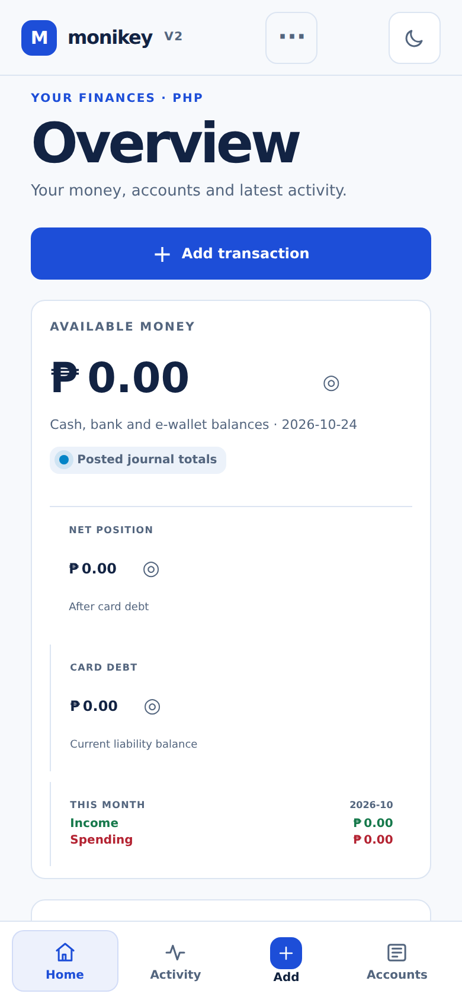
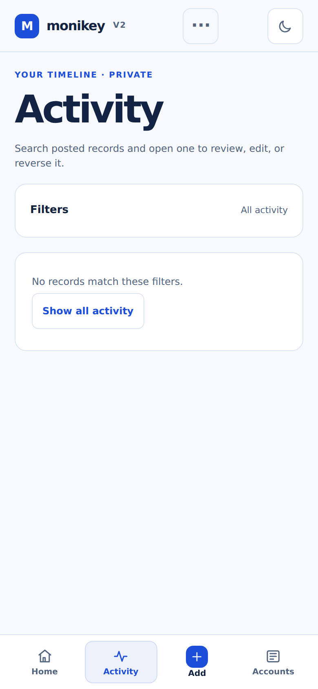
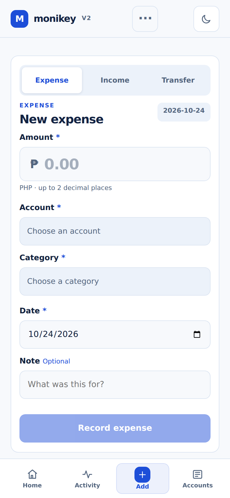
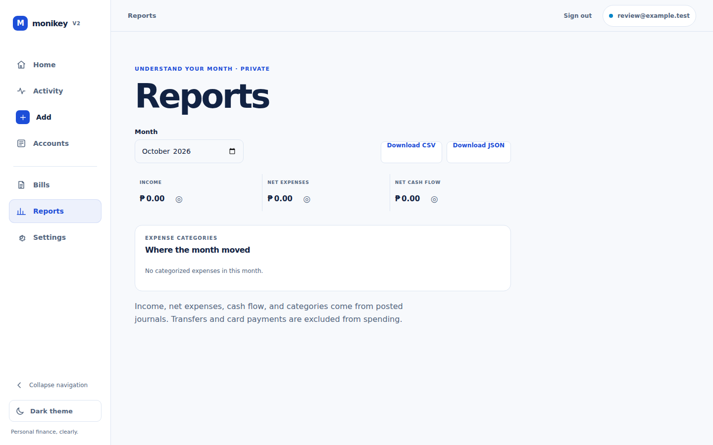
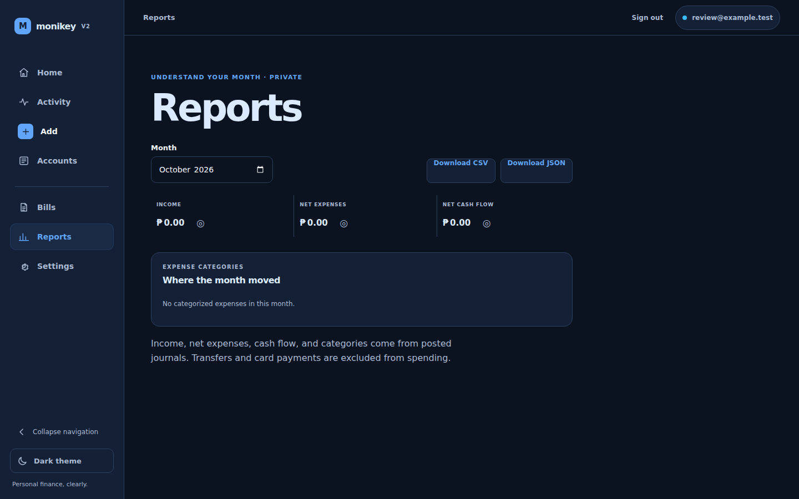

# Financial UI Reliability and Local Review

Captured from the current worktree using the isolated local production web image, Fastify API, and tmpfs PostgreSQL. The review used disposable test accounts and covered the authenticated interface at 360, 390, 768, 1440, and 1920px in light and dark themes.

## Mobile Home — 390px, light

## Mobile Activity — 390px, light

## Mobile Quick Add — 390px, light

## Reports — 1440px

The automated review completed 55 route/viewport checks and 110 light/dark axe scans with zero reported violations. The checks covered overflow, unnamed and undersized controls, keyboard focus, browser/API/console errors, network failures, unhandled rejections, and reduced motion. This is automated browser evidence; screen-reader and physical-device review remain outstanding.
