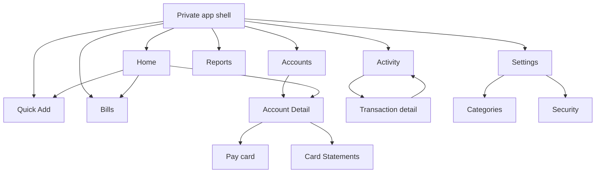
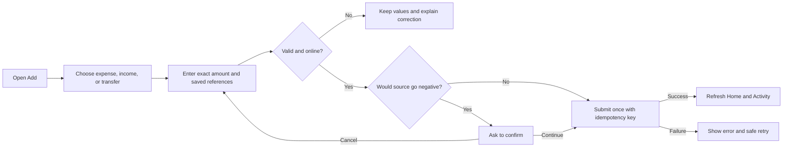

# MoniKey V2 route flows and low-fidelity layouts

Updated: 2026-10-23

Status: implementation-grounded draft for P1-02. It records the current
React routes and interaction paths against the master plan. It is ready for
owner review; it does not claim that navigation or visual direction has been
approved. These layouts describe structure, not final spacing or component
styling.

## Product and layout rules

- One private owner uses the app to understand balances and record activity.
- Posted journal values are the source for account balances, available money,
  card debt, reports, and history. The wireframes never use sample balances.
- Phone uses one content column and a four-item bottom navigation: Home,
  Activity, Add, Accounts. Bills, Reports, and Settings are secondary
  destinations in More.
- Desktop keeps the same destinations in a left rail and places the same page
  content in the main column. Responsive behavior changes navigation and
  grouping, not which product actions exist.
- Quick Add is a contextual sheet when opened from the Add action; a direct URL
  renders the full page. Transactions can only be written while online.
- Empty, loading, error, unauthorized, and confirmation states keep the same
  page hierarchy and explain what can happen next.

## Route and interaction map

### Shared shell

| Phone                                                                                                                                                      | Desktop                                                                                                                                                                                                                                                                                                                                                                                                                             |
| ---------------------------------------------------------------------------------------------------------------------------------------------------------- | ----------------------------------------------------------------------------------------------------------------------------------------------------------------------------------------------------------------------------------------------------------------------------------------------------------------------------------------------------------------------------------------------------------------------------------- |
| `┌ Brand · page title · More/theme ┐` `│ One page column               │` `│                               │` `├ Home · Activity · Add · Accts ┤` | `┌──── left rail ────┬ main page ─────────────┐` `│ Brand             │ page title and actions  │` `│ Home              │ content                 │` `│ Activity          │                         │` `│ Add               │                         │` `│ Accounts          │                         │` `│ More destinations │                         │` `└───────────────────┴─────────────────────────┘` |

## Screen layouts

Each entry gives the intended content order on phone and desktop. Cards and
lists stack on phone; desktop may place related summary panels side by side.
No screen needs a tab bar.

| Screen                         | Phone structure                                                                                                                                                                     | Desktop structure                                                                                   | Main path and verified behavior                                                                                                                                                          |
| ------------------------------ | ----------------------------------------------------------------------------------------------------------------------------------------------------------------------------------- | --------------------------------------------------------------------------------------------------- | ---------------------------------------------------------------------------------------------------------------------------------------------------------------------------------------- |
| Home                           | Available Money and server date → net position/card debt/month totals → account balances → upcoming bills → recent activity → Add transaction                                       | Available Money hero → summary row → accounts and bill/activity panels in columns → Add transaction | Account row opens its detail; View all opens Accounts; Add opens Quick Add. All amounts come from the owner’s posted ledger and bill records.                                            |
| Activity                       | Heading → search/type/account/category/date filters → Apply/Clear → chronological activity rows → Load more                                                                         | Heading and filters above a wider chronological feed; the same filters remain visible               | Filters are URL state; open a row to inspect a transaction revision, edit, or reverse it. Cursor paging appends older entries.                                                           |
| Quick Add                      | Sheet with close control → Expense/Income/Transfer mode → amount → account and category or transfer source/destination → optional fee → date/note → save or warning confirmation    | Direct route is a centered form; contextual Add uses the same form in a dialog/sheet presentation   | Validate exact PHP input and owner records; show pending/error state; warn before a negative source balance; retry with idempotency. Close/backdrop/Escape asks before discarding edits. |
| Accounts                       | Heading and Add account → account rows with type/name/balance → archived toggle → empty state if needed                                                                             | Heading/actions → create form and account list in a wider content column                            | Add an account with a ledger-backed opening balance. Selecting a row opens Account Detail; archived accounts retain history.                                                             |
| Account Detail                 | Account type/name/status → current balance and entry count → card limit/utilization if applicable → Pay card/View statements for active cards → editable metadata → archive/history | Same hierarchy, with card metrics/actions and metadata form in the main column                      | Balance is ledger-derived. Missing or foreign IDs show an unavailable page; archive preserves history.                                                                                   |
| Card Statements                | Card/date context → issuer-snapshot entry form → statement history with amount due and remaining due → back to Accounts                                                             | Form and statement history may sit in separate columns when width permits                           | Enter statement date, due date, optional period, exact amount, and note. Correct a snapshot through an audited edit; allocations remain distinct from total card debt.                   |
| Bills                          | Heading → new recurring bill form → upcoming/overdue occurrence list → actions per occurrence                                                                                       | Form beside or above a wider saved-reminder/occurrence list                                         | Create fixed or variable reminder; review actual amount where needed; pay with a real account/category transaction or skip. No auto-posting.                                             |
| Reports                        | Month picker and exports → income/net expense/net cash-flow totals → category rows/bars with accessible table equivalent                                                            | Month/exports and totals above category visualization/table                                         | Change month; export owner-scoped CSV or JSON. Transfers and card payments are excluded from spending; values reconcile to journal data.                                                 |
| Settings                       | Privacy-mask preview → default balance privacy control → Categories and Security links                                                                                              | Same settings groups in a centered content column                                                   | Change saved privacy preference; navigate to category, session, and password controls.                                                                                                   |
| Card payment (supporting flow) | Card/debt context → source asset account and amount → validation/negative-balance confirmation → submit result                                                                      | Same form in the account detail content region                                                      | Record one card payment journal; do not create a duplicate expense. This is reached from Card Account Detail.                                                                            |

## Key transaction flow

## Required states and owner review

- Every route: loading, empty, recoverable error, and signed-out/private-access
  behavior.
- Quick Add, account creation, bill payment, card payment, and statement edits:
  disabled/pending, validation error, server error, success, and retry behavior.
- Quick Add and payments: offline write prevention; negative-balance warning
  where applicable; no duplicate posting after retry.
- Owner review must assess whether the phone navigation and content order work
  on device, and whether the desktop rail and content grouping are clear. See
  [[OWNER_REVIEW_CHECKLIST]] and [[Release Review]].

## Evidence and open decisions

- Implemented route structure: `apps/web/src/main.tsx`.
- Responsive tokens and navigation rules: `docs/design/DESIGN_SYSTEM.md`.
- Current browser captures: `docs/qa/2026-10-23/RELEASE_REVIEW.md`.
- Automated route review covers five widths, two themes, keyboard traversal,
  reduced motion, and axe WCAG 2.0 A/AA plus 2.2 AA tagged rules. Automated
  coverage does not approve these flows or replace screen-reader/device review.
- Owner decision remains open for navigation clarity, page hierarchy, and
  interaction order. Do not add tabs or new product behavior based on this
  structural draft without an accepted plan change.
