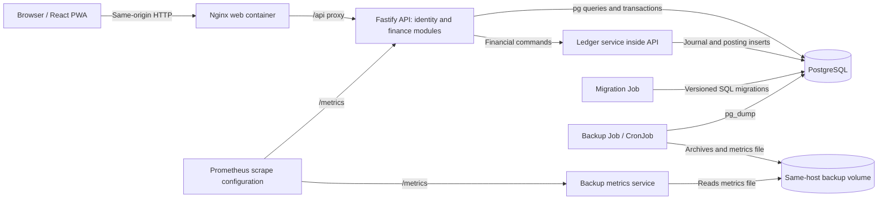

# MoniKey V2 project analysis — 2026-10-24

Reviewed baseline: `ff24ae7` (`main`, matching the local `origin/main` reference). The worktree was clean before this review. Remote refs were not refreshed. This report records a repository-wide architecture and risk review, targeted source inspection, static validation, and PostgreSQL service diagnostics. It is not complete browser, physical-device, live-cluster, or independent release acceptance. Product code was not changed.

## Assessment

The application has substantial launch-scope implementation and a sound financial foundation. It is not ready for financial acceptance: transaction corrections leave bill and statement state inconsistent, and changing recurring rules can generate duplicate reminders that can each be paid. These defects survive the existing green static gate and normal integration cases.

The architecture follows the clean-room V2 boundaries in the inspected source: React/Vite PWA, Fastify modular monolith, direct `pg` runtime access, SQL migrations managed through Prisma tooling, exact minor-unit strings, and one journal-writing service. No runtime mock finance engine was found. This review does not establish historical code provenance against V1.

## Architecture observed in source

Shows configured production components and their call/data relationships at the reviewed baseline. Deployment templates and monitoring configuration do not establish that these services are running in production. Local development uses Vite rather than the production Nginx container.

Evidence: `apps/web/nginx.production.conf`, `apps/api/src/server.ts`, `apps/api/src/ledger/service.ts`, `deploy/kubernetes/`, `deploy/kubernetes/backup/pg-backup-rotate.sh`, `apps/backup-metrics/server.mjs`, and `monitoring/prometheus/`.

## Confirmed findings

Severity follows the master plan's P1/P2 guide. The first four were reproduced by calling the real application services against a disposable PostgreSQL 18 database with all five SQL migrations applied. Each reproduction ran in a transaction and rolled back, with deferred constraints explicitly checked. These are service diagnostics, not API-backed financial E2E acceptance.

### F1 — P1: Voiding a card payment leaves statement due understated

Evidence: `apps/api/src/transactions.ts:1344`, `apps/api/src/card-statements.ts:46`, and `apps/api/src/transactions.ts:1022`.

`deleteTransaction` reverses the ledger and marks the payment VOID, but retains the statement allocation. Both the statement reader and the remaining-allocation check sum allocations without filtering void payment transactions.

Reproduction in minor units: statement due `100000`, allocated payment `40000`, then void the payment. Card liability returned to `100000`; the statement still reported allocated `40000` and remaining `60000`. The user cannot correctly allocate a replacement full payment because the old allocation still consumes remaining due.

Required correction: define audited allocation reversal semantics and use active allocations consistently in statement reads and payment validation. Commit reversal, transaction revision, and allocation state atomically. Cover partial/full payment voids and concurrent replacement payments.

### F2 — P1: Voiding a bill payment leaves the occurrence Paid

Evidence: `apps/api/src/transactions.ts:1344`, `apps/api/src/bills.ts:354`, and `apps/api/src/bills.ts:329`.

A bill payment creates an ordinary EXPENSE. The general void command reverses it without reopening or otherwise reconciling the linked occurrence. Listing occurrences trusts stored status; the pay command rejects PAID occurrences.

Reproduction: pay a fixed occurrence for `10000`, then void its linked transaction. The occurrence retained `status: PAID`, `actualAmountMinor: 10000`, and its now-void transaction reference. The reminder disappears from outstanding dashboard bills while the financial payment no longer exists.

Required correction: specify and implement linked bill-payment correction behavior, including edits to amount/account/date. Lock and reconcile the occurrence and transaction together; preserve payment history and permit a valid replacement payment.

### F3 — P1: Bill-rule edits retain stale future occurrences and can duplicate them

Evidence: `apps/api/src/bills.ts:189` and `apps/api/src/bills.ts:281`.

The dashboard generates future occurrences on reads. Rule updates modify only `bills`; occurrence generation uses `ON CONFLICT ... DO NOTHING`. Existing future amounts are not updated, and changing due day creates a second occurrence under the new date.

Reproduction: generate November's day-25 occurrence for `10000`, then change the rule to day 27 and `20000`. Listing November returned both November 25 / `10000` and November 27 / `20000`, each Upcoming. Each has its own payment identity.

Required correction: reconcile unpaid future occurrences when rules change, with a clear effective date and one logical monthly instance. Preserve paid/skipped history and serialize generation with rule updates. Test amount, due-day, date-range, cadence-boundary, and status changes.

### F4 — P1: Card credit balances can be created without explicit confirmation

Evidence: `apps/api/src/transactions.ts:971`, `apps/api/src/transactions.ts:721`, and master-plan section 4.3.

Payment validation checks funding-account overdraft and optional statement remaining due, but does not require confirmation when overall card liability becomes negative. Refunds and card adjustments also need review under the same policy. Existing acknowledgement fields govern asset negative balances.

Reproduction: card liability `100000`, sufficiently funded bank, unallocated payment `110000`, no acknowledgement. The service accepted it and returned card balance `-10000`.

Required correction: enforce the explicit card-credit confirmation rule on every command that can cross that boundary, expose the projected credit balance, and support the confirmation in the UI. Preserve exact integer arithmetic.

### F5 — P2: Negative-balance confirmation is incomplete in secondary flows

Evidence: `apps/web/src/main.tsx:1683`, `apps/web/src/main.tsx:3468`, and `apps/api/src/transactions.ts:1234`.

Quick Add and card payment have acknowledgement flows. Transaction edit and bill payment omit `acknowledgeNegativeBalance` and have no corresponding confirmation action. A legitimate edit or bill payment that would overdraw an asset receives a conflict with no UI path to affirm it. This conflicts with section 4.3's allow-after-confirmation behavior.

Required correction: reuse a reviewed confirmation interaction in both flows, showing the projected amount and retaining retry identity. Validate keyboard/focus behavior and real API outcomes.

### F6 — P2: Several create forms abandon retry identity after an uncertain response

Evidence: `apps/web/src/main.tsx:2039`, `apps/web/src/main.tsx:2738`, `apps/web/src/main.tsx:3414`, and `apps/web/src/shared/lib/pending-submissions.ts`.

Quick Add and card payment preserve unresolved request keys. Account creation, statement creation, and bill creation generate a fresh UUID on every submission. If the server commits but its response is lost, a user retry can create a second resource. A duplicate account with a nonzero opening balance also posts a second opening journal and changes aggregate money totals.

This is a source-traced failure scenario, not a newly executed browser reproduction. Bill payment additionally generates fresh keys, although its occurrence lock/status prevents a second expense; it returns a conflict rather than replaying the original success.

Required correction: extend unresolved-request identity to these commands and test commit-followed-by-response-loss, refresh, and retries. Keep fingerprints scoped to the owner and operation.

### F7 — P2: Bill editing and archiving are missing from the UI

Evidence: `apps/web/src/main.tsx:3346` and the saved-reminder controls around `apps/web/src/main.tsx:3705`; compare master-plan sections 3 and 4.7.

The API supports rule patches, but the Bills page exposes creation and Pause/Resume only. There is no form for changing a saved rule or archiving it. The Pause/Resume promise also has no rejection handler or pending-state protection, so a network failure can become an unhandled rejection without useful feedback.

Required correction: complete the approved rule lifecycle UI after F3 is resolved, including loading/error handling and historical-payment preservation.

### F8 — P2: Calendar-date and occurrence-window validation is incomplete

Evidence: `packages/contracts/src/index.ts:315`, `apps/api/src/server.ts:1828`, and `apps/api/src/bills.ts:300`.

Several date schemas validate only the shape `YYYY-MM-DD`. Executed schema probes accepted bill start `2026-02-31` and statement payment due `2026-13-99`. PostgreSQL will reject invalid casts through the generic server-error path instead of a stable field validation error. Occurrence date windows also have no maximum span; generation loops per month per active bill and performs inserts from a GET request.

Required correction: validate real calendar dates and supported years consistently before SQL; bound occurrence materialization windows and return field-level 400 errors. Verify far-future/invalid dates and wide-window requests against the actual API.

## Strengths and engineering risks

- **Exact money:** inspected financial calculations use `bigint` or PostgreSQL exact `numeric`; JSON amounts are decimal strings. Floating-point timing metrics are unrelated to money.
- **Ledger integrity:** one service inserts journals/postings; database triggers reject row updates/deletes and enforce balanced journals at commit. Composite foreign keys reinforce owner isolation.
- **Authentication:** opaque hashed session tokens, Argon2id, Secure/HttpOnly session cookies, session-bound CSRF tokens, exact mutation Origin checks, and no public registration. These source observations are not a penetration-test verdict.
- **Exports and reads:** exports stream bounded pages within repeatable-read transactions; CSV has formula-injection mitigation. Monthly report requests also use a consistent snapshot. Dashboard subqueries use separate READ COMMITTED statements, so concurrent writes can produce totals/account rows from different moments; consider one snapshot after separating occurrence materialization.
- **Maintainability:** `main.tsx` has 5,455 lines, `server.ts` 2,204, and `transactions.ts` 1,574 at this baseline. Frontend types and fetch calls often duplicate the shared contracts despite a generated client being present. Extract feature modules incrementally while preserving financial command boundaries.
- **Accessibility:** native controls, labels, focus styling, reduced-motion CSS, a Quick Add dialog, and axe/keyboard browser tests exist. This review did not rerun browser accessibility checks or establish full WCAG conformance.
- **CI evidence:** PR CI runs the static `validate` gate. PostgreSQL/API/browser suites require local execution; the publication verifier checks successful `validate` on the merged PR head. It does not verify attached full-stack financial evidence for the release SHA. Preserve a reviewable, commit-bound full-stack acceptance record before promotion.
- **Release:** digest substitution, migration ordering, pre-migration backups, restrictive containers/network policies, and runbooks exist. Templates still contain placeholder image references. Owner-device trust, secrets integration, live storage/network/restore checks, independent QA, and cutover approval remain open. Same-host backup failure-domain risk is already an accepted product decision.

## Verification performed

- `npm ci`: succeeded; 406 packages installed, audit reported zero vulnerabilities. Runtime was Node `24.20.0`, rather than the CI-pinned Node `22.22.0`.
- `npm run validate`: passed after installation, including lint, typecheck, builds, finance tests, tooling checks, formatting, tracked-file secret scanning, and dependency audit. Initial attempt stopped because dependencies were absent; it was rerun successfully.
- `npm run compose:check`: passed.
- Seven additional dependency-free backup-lock, secret-scan, and release-verifier tests passed before dependency installation completed.
- Five migration SQL files applied successfully to disposable PostgreSQL 18. This used `psql`; it did not test Prisma migration bookkeeping or the configured PostgreSQL 17.6 image.
- Existing ledger, accounts, categories, transactions/dashboard, cards, bills, reports, and idempotency suites passed: 18 tests across eight suite commands. Initial integration attempts stopped on incomplete review fixtures; missing dedicated report/crash users were supplied before targeted reruns. The transfer-crash API process-kill test passed separately after replacing the review fixture's placeholder password with the committed test credential: 19 integration tests passed in total. The earlier authentication failure was a review-fixture error, not a product defect.
- Four targeted PostgreSQL service reproductions confirmed F1–F4; all changes rolled back and deferred constraints passed.
- Schema probes confirmed F8's invalid-date acceptance. A standalone coercion probe also showed `z.coerce.boolean().parse('false') === true` in the bill list schema; HTTP behavior still needs an API-level check because Fastify also coerces schema-validated query parameters.
- Browser E2E, contract comparison against a running API, PostgreSQL 17.6 acceptance, production image builds/scans, and live-cluster validation were not run for this review.

## Recommended order

1. Resolve F1–F4 with real PostgreSQL/API regression cases for linked corrections, recurrence changes, and card-credit confirmation.
2. Complete F5–F7 with real response-loss and confirmation browser journeys.
3. Resolve F8 and verify bounded/invalid-date API behavior.
4. Re-run the documented configured full-stack acceptance environment on the corrected SHA, then independent QA, physical-device review, and owner acceptance.
5. Complete the existing Phase 6 gates before any approved production promotion.
