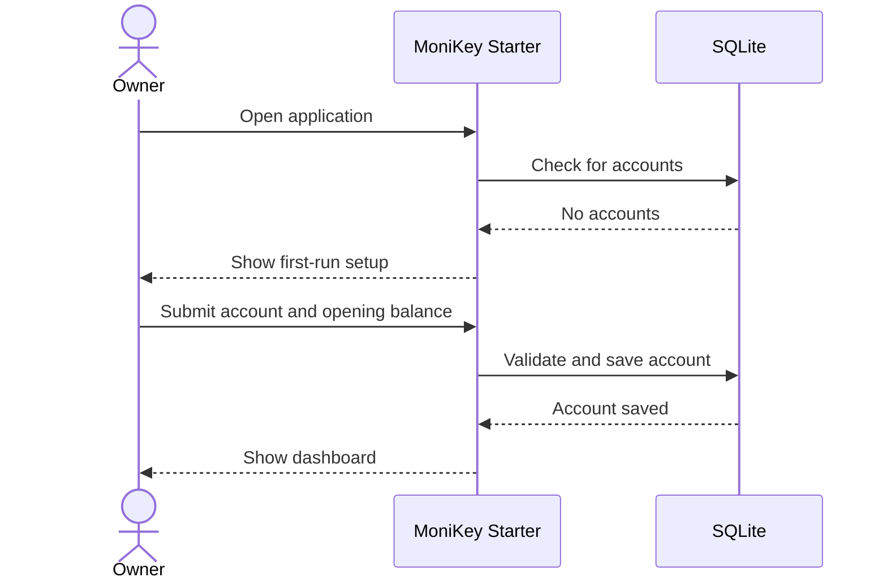
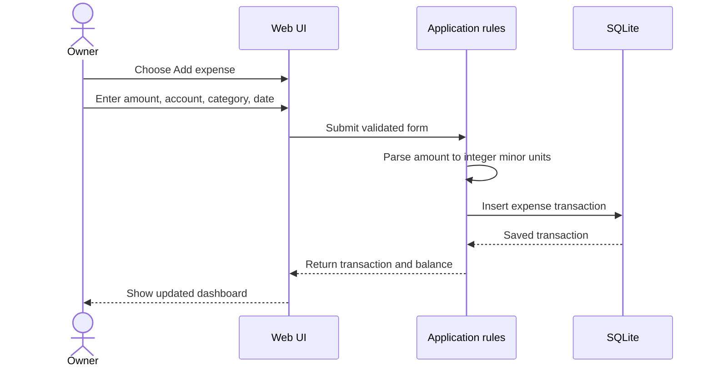

# MoniKey Starter user flows

These flows describe how the first usable version is intended to be used. The
flow names are also the first browser acceptance scenarios.

## Flow 1 — First use

1. The owner opens MoniKey Starter.
2. The app sees an empty database and shows a friendly first-run screen.
3. The owner creates an account, such as `Main bank`, and enters an opening
   balance.
4. The owner creates or accepts starter income and expense categories.
5. The app opens the dashboard with the new account and zero transactions.

## Flow 2 — Record an expense

1. The owner opens the dashboard and chooses **Add expense**.
2. The owner enters amount, account, category, date, and optional note.
3. The app validates the amount and required selections.
4. The app saves one transaction.
5. The dashboard reloads the balance and recent activity from the database.

## Flow 3 — Review history

1. The owner opens **Activity**.
2. The app lists transactions newest first.
3. The owner filters by account or date.
4. The owner opens a transaction to edit or delete it.
5. The app saves the change and refreshes the list and balance.

## Screen map

| Screen          | Purpose                                          | Entry point          |
| --------------- | ------------------------------------------------ | -------------------- |
| First run       | Create the first account                         | Empty database       |
| Dashboard       | See total balance, accounts, and recent activity | App start            |
| Add transaction | Record income or expense                         | Dashboard action     |
| Activity        | Review and filter saved transactions             | Dashboard navigation |
| Settings        | Manage accounts and categories                   | Dashboard navigation |

## Required states

Every Starter screen must have a readable state for:

- loading;
- empty data;
- invalid form input;
- database or network failure; and
- successful completion.

The app does not silently invent balances, hide a failed save, or require the
owner to understand server logs to recover.
