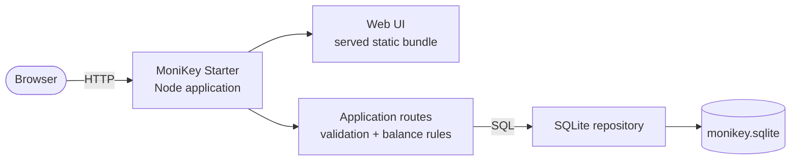
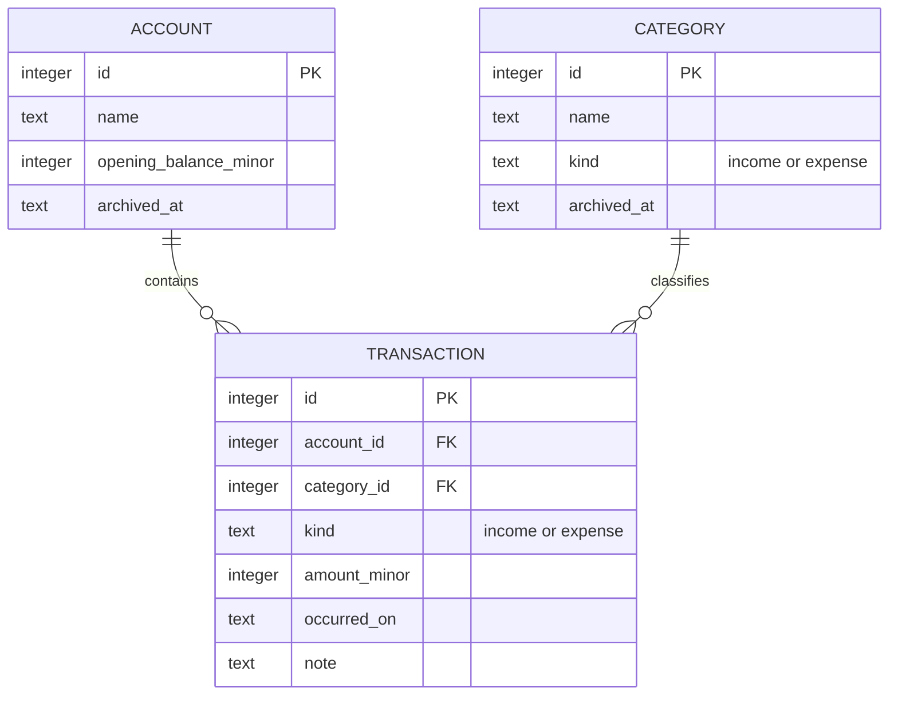

# MoniKey Starter top-level design (TLD)

Status: planned design for `starter/monikey-starter`; this is not a diagram of
the paused V2 deployment.

## Design question

This document answers: **what are the smallest runtime boundaries and how do
they fit together?** It intentionally does not describe Kubernetes, release
pipelines, or the full V2 financial architecture.

## Runtime shape

Shows the planned single-process runtime and its local persistence boundary.
It does not show future deployment, authentication, or advanced finance
features.

## Responsibilities

| Area                | Responsibility                                              | Must not do                              |
| ------------------- | ----------------------------------------------------------- | ---------------------------------------- |
| Web UI              | Render screens, collect input, display server results       | Recalculate authoritative balances       |
| Application routes  | Parse requests, validate input, call domain rules           | Contain database-specific SQL everywhere |
| Domain rules        | Parse money, apply income/expense signs, calculate balances | Know about HTTP or browser state         |
| SQLite repository   | Read and write accounts, categories, and transactions       | Decide what a valid user action means    |
| Database migrations | Create and evolve the small local schema                    | Become a production deployment system    |

## Starter data model

Amounts are stored as integer minor units. For example, PHP 125.50 is stored
as `12550`. JSON and form values are strings until validated; JavaScript
floating-point arithmetic is never used for financial values.

## Deliberate simplifications

- There is one local owner, so no `user_id` ownership model is needed yet.
- Income and expense are the only transaction kinds.
- A balance is derived from opening balance plus signed transactions.
- SQLite is a file in the project data directory; reset means deleting that
  local file and rerunning migrations.
- The UI and API share one process, but still use a small internal boundary so
  later growth does not require rewriting every screen.
